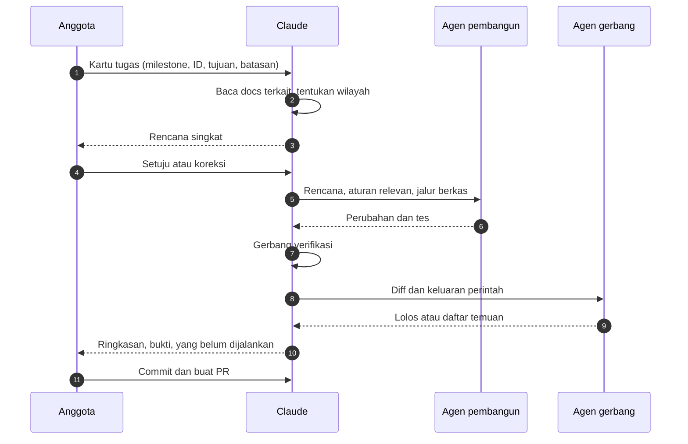
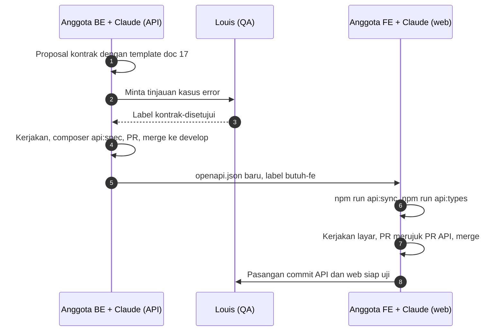

[Profil organisasi](https://github.com/DraftAja) · [Semua milestone](../milestone/README.md) · [Serah terima](../serah-terima/README.md)

# Panduan kerja dengan Claude Code dan tim agen

Halaman ini menjelaskan cara memakai Claude Code di kedua repo kode DraftAja: apa yang sudah disiapkan, persiapan sekali per anggota, alur satu tugas dari awal sampai PR, contoh prompt, tim agen per peran, dan cara merawat aturannya.

> [!IMPORTANT]
> Susunan ini masuk lewat 🔒 [Backend-Laravel #14](https://github.com/DraftAja/Backend-Laravel/pull/14) dan 🔒 [Frontend-Nextjs #14](https://github.com/DraftAja/Frontend-Nextjs/pull/14). Keduanya ditumpuk di atas PR #13 di repo masing-masing. Sampai kedua PR itu merge ke `develop`, berkas di bawah hanya ada di branch `docs/be-ai-aturan-agen` dan `docs/fe-aturan-agen`.

## Daftar isi

1. [Prinsip](#prinsip)
2. [Yang sudah disiapkan di repo](#yang-sudah-disiapkan-di-repo)
3. [Persiapan sekali per anggota](#persiapan-sekali-per-anggota)
4. [Alur satu tugas](#alur-satu-tugas)
5. [Contoh prompt](#contoh-prompt)
6. [Tim agen](#tim-agen)
7. [Alur per peran](#alur-per-peran)
8. [Fitur lintas repo](#fitur-lintas-repo)
9. [Gerbang verifikasi dan bukti](#gerbang-verifikasi-dan-bukti)
10. [Mengelola sesi](#mengelola-sesi)
11. [Merawat aturan dan agen](#merawat-aturan-dan-agen)
12. [Masalah umum](#masalah-umum)
13. [Batasan](#batasan)

## Prinsip

1. **Manusia memutuskan, agen mengerjakan.** Claude berhenti dan bertanya sebelum hal yang sulit dibatalkan: migration, perubahan kontrak v1, dependensi, berkas milik peran lain, commit, push.
2. **Satu sumber aturan.** Aturan proyek ditulis sekali di `AGENTS.md`. Alat lain (Codex, Cursor, Copilot, Gemini CLI) membaca berkas yang sama.
3. **Bukti, bukan klaim.** Pekerjaan baru dianggap selesai bila keluaran perintah verifikasi ada di laporan. "Sudah dites" tanpa keluaran tidak diterima.
4. **Pembuat dan pemeriksa dipisah.** Setiap tim punya satu agen gerbang yang tidak memeriksa hasil tulisannya sendiri.
5. **Satu tugas, satu sesi, satu branch.** Konteks yang bersih membuat Claude lebih patuh pada aturan.

## Yang sudah disiapkan di repo

| Berkas | Isi | Dibaca oleh | Diubah oleh |
|---|---|---|---|
| `AGENTS.md` | Proyek, perintah, hard rules, tempat mencari, alur kerja, gerbang verifikasi, aturan git, keputusan yang masih terbuka | Semua alat AI. Claude membacanya lewat impor | Siapa saja, lewat PR |
| `CLAUDE.md` | Baris `@AGENTS.md`, lalu cara kerja khusus Claude: hal yang wajib ditanyakan, tim agen, aturan delegasi, skill, cara melapor | Claude Code | Siapa saja, lewat PR |
| `app/`, `database/`, `docs/CLAUDE.md` (API) | Satu baris `@AGENTS.md` agar aturan per folder ikut terbaca | Claude Code, saat bekerja di folder itu | Jarang diubah |
| `.claude/agents/*.md` | 12 agen di API, 10 agen di web, dari [msitarzewski/agency-agents](https://github.com/msitarzewski/agency-agents) (MIT) | Claude Code | Disalin apa adanya dari upstream |
| `.claude/settings.local.json`, `CLAUDE.local.md` | Setelan dan catatan pribadi | Hanya di komputer masing-masing | Di-ignore git |

Claude Code tidak membaca `AGENTS.md` bila ada `CLAUDE.md`. Karena itu setiap `CLAUDE.md` di repo ini dimulai dengan `@AGENTS.md`. Isi `CLAUDE.md` dimuat bersama dengan semua `CLAUDE.md` di folder induk, jadi jangan menaruh `CLAUDE.md` berisi aturan lain di folder `DraftAja-split/` atau folder induk lain tanpa dibicarakan.

## Persiapan sekali per anggota

1. **Pasang atau perbarui Claude Code.** Susunan ini diuji dengan versi 2.1.318. Cek dengan `claude --version`.
2. **Ambil branch terbaru** di kedua repo (`develop`, atau branch PR di atas sebelum merge).
3. **Atur PHP** untuk anggota yang menjalankan API: `session.upload_progress.enabled = Off` di `php.ini` dan PHP minimal 8.4.27 atau 8.5.12. Tanpa ini `composer verify` sengaja gagal.
4. **Pasang skill tambahan (disarankan).** `CLAUDE.md` merujuk skill ini dengan syarat "bila terpasang", jadi alur tetap berjalan tanpanya. Skill dipasang per komputer:

   ```bash
   npx skills add obra/superpowers@systematic-debugging -g -y
   npx skills add obra/superpowers@verification-before-completion -g -y
   npx skills add obra/superpowers@writing-plans -g -y
   npx skills add mattpocock/skills@tdd -g -y
   # khusus FE dan QA
   npx skills add ueberdosis/tiptap@tiptap -g -y
   npx skills add currents-dev/playwright-best-practices-skill@playwright-best-practices -g -y
   npx skills add addyosmani/web-quality-skills@accessibility -g -y
   ```

5. **Periksa susunannya.** Buka Claude Code dari dalam folder repo, bukan dari folder di atasnya, lalu:
   - Ketik `/memory`. Harus tampil `./CLAUDE.md` dan di bawahnya `AGENTS.md` bertanda `@-imported`.
   - Ketik prompt berikut. Daftar agen proyek harus lengkap (12 di API, 10 di web).

     ```text
     Tanpa memakai tool apa pun, jawab tiga hal:
     1. Berkas instruksi apa saja yang dimuat di sesi ini?
     2. Sebutkan 3 "Hard rules" pertama dari AGENTS.md.
     3. Sebutkan semua subagen proyek ini per tim sesuai CLAUDE.md, tandai agen gerbangnya.
     ```

   Menu `/agents` sudah dihapus dari Claude Code. Pesan "The /agents wizard has been removed" bukan tanda agen gagal dimuat.

## Alur satu tugas



| Langkah | Yang dilakukan anggota | Yang dilakukan Claude |
|---|---|---|
| 1. Siapkan branch | `git switch develop && git pull`, lalu `git switch -c <tipe>/<alias>-<deskripsi>` sesuai contoh branch di halaman milestone | |
| 2. Beri tugas | Tulis kartu tugas (lihat [contoh prompt](#contoh-prompt)) | Membaca `docs/12`, `docs/18`, atau `docs/06`, menentukan wilayah dan pemilik |
| 3. Setujui rencana | Periksa berkas, tes, dan doc yang akan diubah. Ini titik paling murah untuk mengubah arah | Menulis rencana. Untuk tugas besar, pakai mode rencana (`Shift+Tab`) |
| 4. Pengerjaan | Jawab bila Claude bertanya | Bug: tes merah dulu, baru perbaikan. Fitur: kode dan tes. Delegasi ke agen pembangun |
| 5. Verifikasi | | Menjalankan [gerbang verifikasi](#gerbang-verifikasi-dan-bukti) dan membaca keluarannya |
| 6. Pemeriksaan | Tagih bukti bila laporan hanya berisi klaim | Mengirim diff dan keluaran ke agen gerbang, memperbaiki temuan |
| 7. PR | Minta commit dan PR, lalu baca diff sendiri sebelum minta review | Commit Conventional Commits, PR dengan template repo, menautkan PR pasangan |

## Contoh prompt

### Kartu tugas

Pakai bentuk ini untuk setiap tugas baru. Semakin jelas batas "selesai bila", semakin kecil peluang Claude melebar ke pekerjaan lain.

```text
Milestone: AI-3
Butir: BE-08 (GET /ai/quota)
Tujuan: pengguna bisa melihat sisa kuota AI hari ini.
Batasan: jangan ubah bentuk respons endpoint lain, jangan sentuh migration.
Selesai bila: tes fitur sukses, 401 tamu, dan perhitungan setelah satu perapihan lolos;
openapi.json diperbarui; doc 05 dan doc 18 diperbarui.
Buat rencana dulu, tunggu persetujuan saya.
```

### Situasi lain

| Situasi | Prompt |
|---|---|
| Bug | "Ada bug: <gejala>. Pakai systematic-debugging. Tulis tes yang gagal dulu, tunjukkan keluarannya, baru perbaiki." |
| Lanjut kemarin | "Lanjutkan branch ini. Baca `git log` dan `git diff develop`, lalu ringkas apa yang sudah dan belum selesai." |
| Memanggil agen | "Pakai Prompt Engineer untuk menulis ulang `ChatPrompt`, lalu Model QA Specialist mengujinya dengan kasus angka dan tanggal." |
| Kerja paralel | "Jalankan paralel: Backend Architect merancang endpoint, API Tester menyiapkan daftar kasus uji. Gabungkan hasilnya jadi satu rencana." |
| Gerbang | "Minta Reality Checker memeriksa perubahan ini. Sertakan diff dan keluaran tes. Jangan perbaiki apa pun sebelum saya baca temuannya." |
| Review sebelum PR | "Jalankan /code-review. Bila menyentuh auth, unggah, atau AI, lanjutkan /security-review." |
| Selesai | "Commit dengan Conventional Commits dan buat PR ke develop memakai template repo." |
| Menulis doc | "Perbarui doc 18 untuk BE-08. Ikuti aturan menulis di AGENTS.md dan pakai humanizer." |

## Tim agen

Setiap repo punya dua tim. Agen pembangun mengerjakan, agen gerbang memeriksa. Sebut nama agen di prompt bila ingin agen tertentu yang bekerja.

### Backend-Laravel

| Tim | Agen | Dipakai untuk |
|---|---|---|
| Tim 1 Core Dokumen (`be-core`) | Backend Architect | Desain service, controller tipis, alur dokumen dan template |
| | API Platform Engineer | Bentuk endpoint, versi `/api/v1`, proposal kontrak |
| | Identity & Access Engineer | Session Sanctum, policy, middleware sesi |
| | Database Optimizer | Migration baru, indeks, kesiapan PostgreSQL 16 |
| | PDF Engine Architect | Ekspor PDF dan tata letak A4 |
| | **API Tester** (gerbang) | Tes fitur: sukses, setiap `code` error, akses pengguna lain |
| Tim 2 AI (`be-ai`) | AI Engineer | Klien Groq dan Gemini, retry, kuota, job antrean |
| | Prompt Engineer | Isi prompt dan konsistensi output |
| | Model QA Specialist | Validator output, pembelajaran pola, regresi prompt |
| | AI-Generated Code Security Auditor | Prompt injection dari isi dokumen, kebocoran kunci |
| | Application Security Engineer | Unggahan berkas, sanitasi HTML, otorisasi |
| | **Reality Checker** (gerbang) | Bukti akhir sebelum PR. Bawaannya "NEEDS WORK" sampai buktinya cukup |

### Frontend-Nextjs

| Tim | Agen | Dipakai untuk |
|---|---|---|
| Tim 1 Produk dan Antarmuka (`fe`) | Frontend Developer | App Router, TanStack Query, editor TipTap |
| | UX Architect | Alur layar, keadaan kosong, memuat, dan error, tata letak 360 px |
| | UI Designer | Komponen dasar dan token desain |
| | Accessibility Auditor | Kontras, fokus, label, keyboard |
| | **UI Finish-Gate Reviewer** (gerbang) | Tampilan siap rilis dan konsisten dengan doc 05 web |
| Tim 2 Kualitas dan Integrasi (`qa`) | Test Automation Engineer | Playwright desktop dan ponsel, selektor stabil |
| | Evidence Collector | Laporan bug dengan langkah ulang dan tangkapan layar |
| | Performance Benchmarker | Landing, ukuran bundle, kecepatan editor |
| | Application Security Engineer | Proxy same-origin, cookie, sanitasi HTML |
| | **Code Reviewer** (gerbang) | Review PR: kebenaran, kontrak tipe, aturan `AGENTS.md` |

### Aturan delegasi

- Agen gerbang tidak pernah memeriksa hasil yang ia tulis sendiri.
- Agen dengan wilayah berkas terpisah boleh berjalan paralel. Agen yang menulis berkas yang sama dijalankan berurutan.
- Subagen tidak otomatis tahu aturan yang relevan. Claude utama wajib menyertakan hard rules terkait dan jalur berkas di prompt delegasi.
- Laporan subagen wajib memuat perintah yang dijalankan dan hasilnya. Claude utama membaca diff dan menjalankan tes sendiri sebelum melapor.

## Alur per peran

| Anggota | Repo | Tim | Gerbang | Pemakaian utama |
|---|---|---|---|---|
| Raja · PM | Keduanya | Tidak memakai tim agen | Memutuskan "Open decisions" di `AGENTS.md` | Meringkas PR, memeriksa kelengkapan serah terima, menyusun proposal kontrak bersama BE |
| Octaf · BE 1 | Backend-Laravel | Tim 1 Core Dokumen | API Tester | [CORE-1](../milestone/CORE-1.md) sampai [CORE-5](../milestone/CORE-5.md) |
| Hamid · BE 2 | Backend-Laravel | Tim 2 AI | Reality Checker | [AI-1](../milestone/AI-1.md) sampai [AI-5](../milestone/AI-5.md) |
| Alvira · FE | Frontend-Nextjs | Tim 1 Produk dan Antarmuka | UI Finish-Gate Reviewer | [WEB-1](../milestone/WEB-1.md) sampai [WEB-5](../milestone/WEB-5.md) |
| Louis · QA | Frontend-Nextjs, juga tes di API | Tim 2 Kualitas dan Integrasi | Code Reviewer | [QA-1](../milestone/QA-1.md) sampai [QA-5](../milestone/QA-5.md) |

Contoh pemakaian per peran:

- **Raja:** "Ringkas semua PR terbuka di kedua repo: milestone, status CI, serah terima yang menunggu."
- **Octaf:** "Kerjakan BE-01 di CORE-1. Tes dulu: dokumen final harus bisa diekspor PDF dan DOCX." Lalu "Minta API Tester memeriksa cakupan tesnya."
- **Hamid:** "Kerjakan KF-AI-05 di AI-3. Prompt Engineer menulis prompt, Model QA Specialist menguji, Reality Checker memeriksa akhir."
- **Alvira:** "Kerjakan layar kuota AI sesuai doc 03 web. Semua keadaan ditangani, cek di 360 px. Lalu UI Finish-Gate Reviewer."
- **Louis:** "Test Automation Engineer: tulis E2E alur buat dokumen sampai unduh DOCX, profil desktop dan ponsel. Evidence Collector: catat setiap kegagalan dengan langkah ulang."

## Fitur lintas repo

Fitur yang butuh endpoint baru atau berubah selalu mengikuti urutan ini. Detailnya ada di 🔒 [doc 17](https://github.com/DraftAja/Backend-Laravel/blob/develop/docs/17-kolaborasi-dan-serah-terima.md) dan halaman [serah terima](../serah-terima/README.md).



Prompt pembuka di repo web setelah PR API merge:

```text
PR API #<nomor> sudah merge ke develop. Jalankan npm run api:sync dan npm run api:types,
lalu kerjakan layar <nama> sesuai doc 03. Jangan menulis tipe respons dengan tangan.
```

## Gerbang verifikasi dan bukti

| Repo | Perintah | Kapan |
|---|---|---|
| Backend-Laravel | `php artisan test` | Selalu |
| | `composer analyse` | Selalu |
| | `vendor/bin/pint --test --diff=origin/develop` | Selalu. Hanya berkas yang berubah, agar migration lama tidak tersentuh |
| | `composer api:spec && git diff --exit-code -- docs/api/openapi.json` | Bila rute atau resource berubah. Commit hasilnya |
| Frontend-Nextjs | `npm run api:check && npm run typecheck && npm run lint && npm run format:check && npm test && npm run build` | Selalu |
| | `npm run test:e2e` | Bila alur pengguna berubah. Butuh API yang berjalan dengan seeder |

Laporan akhir Claude wajib memuat:

1. Perintah yang dijalankan beserta hasilnya.
2. Langkah yang tidak dijalankan dan alasannya. Contoh: tes PostgreSQL, provider AI sungguhan, E2E perapihan dan PDF yang belum bisa ditulis karena FE-27.
3. Doc yang ikut diubah dan ID temuan yang ditutup (`BE-xx`, `FE-xx`, `S-xx`).
4. Untuk perubahan tampilan: tangkapan layar 360 px dan desktop, atau keterangan bahwa belum diambil.
5. Untuk perubahan kontrak: langkah yang harus dilakukan di repo web.

## Mengelola sesi

| Kebutuhan | Cara |
|---|---|
| Mulai tugas baru | Sesi baru, atau `/clear` sebelum tugas berikutnya. Jangan menumpuk dua tugas di satu sesi |
| Melanjutkan sesi terakhir | `claude --continue`, atau `claude --resume` untuk memilih sesi |
| Merencanakan tanpa mengubah berkas | Mode rencana dengan `Shift+Tab` |
| Konteks mulai penuh | `/compact`. `CLAUDE.md` sudah meminta Claude mempertahankan daftar berkas, perintah verifikasi, dan keputusan yang menunggu |
| Membatalkan langkah Claude | `/rewind` untuk kembali ke titik sebelumnya, atau `git restore`/`git stash` untuk perubahan berkas |
| Memeriksa aturan yang dimuat | `/memory` |

## Merawat aturan dan agen

**Menambah aturan.** Tambahkan aturan hanya setelah Claude membuat kesalahan yang bisa terulang. Tulis aturan yang bisa diperiksa: "Jalankan `npm test` sebelum commit", bukan "Pastikan kode teruji". Aturan untuk semua alat masuk `AGENTS.md`, aturan khusus Claude masuk `CLAUDE.md`. Ubah lewat PR dengan scope `docs`.

**Ukuran.** `CLAUDE.md` di bawah 120 baris, `AGENTS.md` di bawah 200 baris. Aturan yang hanya berlaku di satu folder masuk ke `AGENTS.md` folder itu.

**Audit.** Jalankan `/doctor prompt-audit` sebulan sekali atau setelah perubahan besar. Perintah ini mencari aturan yang usang, rujukan ke berkas yang sudah tidak ada, dan aturan yang saling bertentangan.

**Agen.** Berkas di `.claude/agents/` disalin apa adanya dari upstream dan dikecualikan dari Prettier di repo web. Untuk memperbarui, salin versi baru dari upstream lewat PR. Untuk menambah agen:

1. Pilih agen dari [daftar agency-agents](https://github.com/msitarzewski/agency-agents) dan jelaskan alasannya di PR.
2. Salin berkasnya ke `.claude/agents/`.
3. Tambahkan ke tabel tim di `CLAUDE.md` repo itu dan di halaman ini.
4. Periksa dengan prompt daftar subagen di [persiapan](#persiapan-sekali-per-anggota).

## Masalah umum

| Gejala | Penyebab | Perbaikan |
|---|---|---|
| Agen proyek tidak muncul | Sesi dibuka dari luar folder repo | Keluar, `cd` ke folder repo, buka ulang |
| Satu agen tidak muncul | Frontmatter berkas rusak | Bandingkan dengan berkas upstream, perbaiki lewat PR |
| `/memory` tidak menampilkan `AGENTS.md` | Baris `@AGENTS.md` terhapus atau berada di dalam blok kode | Kembalikan baris itu di luar blok kode |
| Claude bilang tes lolos tanpa keluaran | Laporan melanggar `CLAUDE.md` | Minta keluaran perintahnya. Tolak klaim tanpa bukti |
| `composer verify` gagal di lokal | `session.upload_progress.enabled` masih `On` | Ubah di `php.ini`. Kegagalan ini disengaja |
| `format:check` web gagal pada berkas agen | `.claude/agents` hilang dari `.prettierignore` | Tambahkan kembali |
| Claude mengubah banyak berkas di luar tugas | Kartu tugas tanpa batasan | Tulis "Batasan" dan "Selesai bila" di kartu tugas, minta rencana dulu |
| Aturan saling bertentangan | Aturan baru tidak dicek terhadap yang lama | `/doctor prompt-audit`, lalu satukan lewat PR |

## Batasan

- Agen AI tidak menggantikan review manusia. Setiap PR tetap direview anggota sesuai `TEAM_CONTRACT.md` dan CODEOWNERS.
- Jangan menempelkan isi `.env`, kunci API, token, atau dokumen asli pengguna ke prompt.
- Agen gerbang hanya menilai bukti yang diberikan. Bila ada langkah yang tidak dijalankan, keputusan rilis tetap di tangan PM dan QA.
- `AGENTS.md` dan `CLAUDE.md` bersifat panduan, bukan penegak aturan. Aturan yang wajib dipaksakan, misalnya larangan `migrate:fresh`, sebaiknya ditambah sebagai larangan izin atau hook Claude Code. Ini belum disiapkan.
