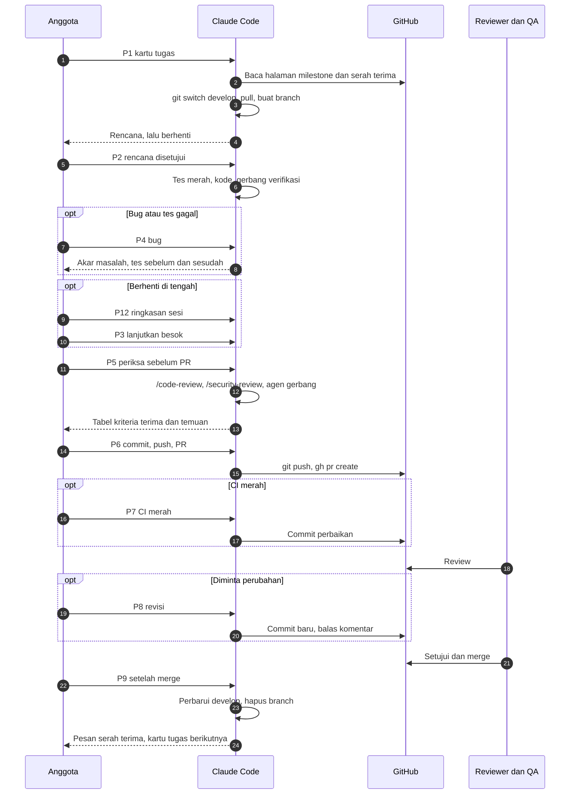
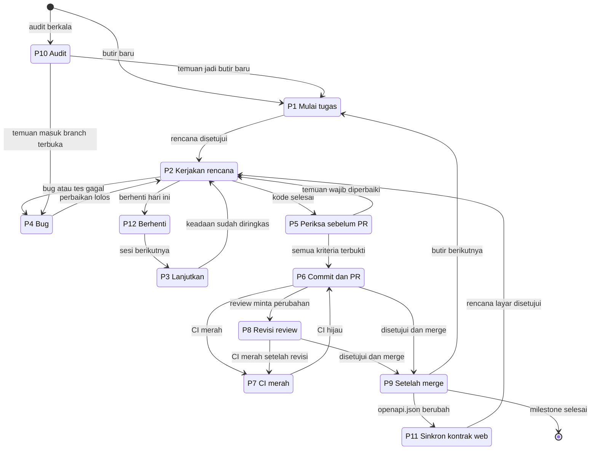

[Profil organisasi](https://github.com/DraftAja) · [Panduan kerja dengan agen AI](kerja-dengan-agen-ai.md) · [Semua milestone](../milestone/README.md) · [Serah terima](../serah-terima/README.md)

# Prompt siap pakai untuk Claude Code

Halaman ini berisi prompt yang bisa langsung disalin ke Claude Code untuk setiap tahap satu tugas: mulai, kerjakan, lanjutkan, bug, periksa, PR, CI merah, review, setelah merge, audit, sinkron kontrak, dan berhenti. Perintah git (`git switch`, `git pull`, membuat branch, commit, push, PR) sudah ada di dalam prompt, jadi Claude yang menjalankannya.

Prompt ditulis untuk dipakai berulang. Yang diubah hanya blok di bagian atas prompt (misalnya `KARTU TUGAS`). Bagian `CARA KERJA` di bawahnya tidak perlu diubah. Isi tugas diambil Claude sendiri dari [halaman milestone](../milestone/README.md), jadi kamu cukup menulis ID milestone dan ID butir.

## Daftar isi

1. [Sebelum memakai prompt](#sebelum-memakai-prompt)
2. [Alur kerja](#alur-kerja)
3. [Prompt mana yang dipakai](#prompt-mana-yang-dipakai)
4. [P1 · Mulai tugas](#p1--mulai-tugas)
5. [P2 · Kerjakan rencana](#p2--kerjakan-rencana)
6. [P3 · Lanjutkan pekerjaan](#p3--lanjutkan-pekerjaan)
7. [P4 · Bug](#p4--bug)
8. [P5 · Periksa sebelum PR](#p5--periksa-sebelum-pr)
9. [P6 · Commit, push, dan PR](#p6--commit-push-dan-pr)
10. [P7 · CI merah](#p7--ci-merah)
11. [P8 · Revisi setelah review](#p8--revisi-setelah-review)
12. [P9 · Setelah merge](#p9--setelah-merge)
13. [P10 · Audit](#p10--audit)
14. [P11 · Sinkron kontrak di repo web](#p11--sinkron-kontrak-di-repo-web)
15. [P12 · Berhenti untuk hari ini](#p12--berhenti-untuk-hari-ini)
16. [Kebiasaan yang membuat prompt ini bekerja](#kebiasaan-yang-membuat-prompt-ini-bekerja)

## Sebelum memakai prompt

- Persiapan sekali per anggota di [panduan kerja](kerja-dengan-agen-ai.md#persiapan-sekali-per-anggota) sudah selesai: `/memory` menampilkan `AGENTS.md`, dan daftar agen proyek lengkap.
- `gh` sudah login (`gh auth status`). Prompt memakai `gh api` untuk membaca halaman milestone di repo ini, dan `gh pr` untuk PR.
- Claude Code dibuka dari dalam folder repo yang dikerjakan, bukan dari folder induknya.
- Satu tugas, satu sesi. Ketik `/clear` sebelum menempel P1 untuk butir berikutnya.

Prompt di halaman ini menjalankan aturan nama branch organisasi, `<tipe>/<alias>-<milestone>-<deskripsi>` (contoh `fix/be-core-core1-policy-ekspor`), yang lebih rinci dari contoh di `AGENTS.md`. Instruksi di chat menang atas `AGENTS.md`, jadi Claude akan memakai bentuk ini.

`CLAUDE.md` meminta Claude bertanya sebelum commit, push, dan membuat PR. Izin itu diberikan sekali per tahap lewat kalimat "Saya mengizinkan ..." di P6, P7, dan P8. Prompt lain tidak memberi izin tersebut, jadi Claude tetap berhenti.

## Alur kerja

Lajur di bawah menunjukkan siapa melakukan apa dan prompt mana yang ditempel di setiap titik.



Perpindahan antar-prompt, termasuk audit dan sinkron kontrak yang tidak ada di lajur di atas:



## Prompt mana yang dipakai

| Situasi | Prompt | Yang kamu isi |
|---|---|---|
| Mulai butir baru dari halaman milestone | [P1](#p1--mulai-tugas) | Milestone, butir, tipe dan deskripsi branch |
| Rencana sudah dibaca dan benar | [P2](#p2--kerjakan-rencana) | Koreksi bila ada |
| Membuka lagi pekerjaan kemarin | [P3](#p3--lanjutkan-pekerjaan) | Ringkasan dari P12 bila ada |
| Menemukan bug, menerima issue bug, atau tes gagal | [P4](#p4--bug) | Gejala, langkah ulang, seharusnya |
| Kode selesai, belum commit | [P5](#p5--periksa-sebelum-pr) | Tidak ada |
| Sudah lolos pemeriksaan, siap PR | [P6](#p6--commit-push-dan-pr) | Nomor issue bila ada |
| CI di PR merah | [P7](#p7--ci-merah) | Tidak ada |
| Reviewer meminta perubahan | [P8](#p8--revisi-setelah-review) | Nomor PR, boleh membalas komentar atau tidak |
| PR sudah merge | [P9](#p9--setelah-merge) | Nomor PR |
| Mengecek status milestone, keamanan, atau doc | [P10](#p10--audit) | Jenis audit |
| PR API yang mengubah kontrak sudah merge, layar web perlu menyesuaikan | [P11](#p11--sinkron-kontrak-di-repo-web) | Nomor PR API, butir web |
| Selesai untuk hari ini, pekerjaan belum selesai | [P12](#p12--berhenti-untuk-hari-ini) | Tidak ada |

## P1 · Mulai tugas

Prompt utama. Tempel di sesi baru. Contoh isian memakai BE-01 di [CORE-1](../milestone/CORE-1.md). Nilai tipe dan deskripsi branch bisa disalin dari baris "Contoh branch" di halaman milestone.

```text
KARTU TUGAS (ubah bagian ini saja)
Milestone: CORE-1
Butir: BE-01
Tipe branch: fix
Deskripsi branch: policy-ekspor
Catatan tambahan: -
Batasan tambahan: -

CARA KERJA (jangan diubah)
Ikuti AGENTS.md dan CLAUDE.md repo ini. Kerjakan langkah di bawah berurutan dan laporkan hasil setiap langkah.

1. Cek tempat kerja
   - Jalankan git rev-parse --show-toplevel, git remote get-url origin, dan git status --short.
   - Pastikan repo ini cocok dengan milestone: CORE dan AI di Backend-Laravel, WEB di Frontend-Nextjs, QA dan PM bisa di keduanya. Bila tidak cocok, berhenti.
   - Bila ada perubahan yang belum di-commit, berhenti. Tampilkan daftarnya dan tanya saya: commit, stash, atau buang. Jangan memutuskan sendiri.

2. Siapkan branch
   - Nama branch: <tipe>/<alias>-<milestone huruf kecil tanpa strip>-<deskripsi>. Alias mengikuti pemilik milestone: CORE = be-core, AI = be-ai, WEB = fe, QA = qa, PM = pm. Contoh: fix/be-core-core1-policy-ekspor.
   - git fetch origin, git switch develop, git pull --ff-only origin develop.
   - Bila branch itu sudah ada di lokal atau di origin (git ls-remote --heads origin <branch>), pindah ke branch itu, ringkas git log --oneline develop..HEAD, dan jangan membuatnya ulang.
   - Bila belum ada: git switch -c <branch>.

3. Baca tugas dari sumbernya
   - Ambil halaman milestone: gh api repos/DraftAja/.github/contents/milestone/<Milestone>.md -H "Accept: application/vnd.github.raw"
   - Ambil baris butir di "Ringkasan pekerjaan" dan bagian butir di "Rincian pekerjaan": masalah sekarang, langkah, bukti selesai, hindari. Kriteria terima di halaman itu adalah definisi selesai.
   - Periksa "Mulai setelah" dan serah terima yang masuk ke milestone ini. Bila perlu, ambil halaman serah-terima/H<n>.md dengan cara yang sama. Bila prasyarat belum terpenuhi, sebutkan dan tanya saya apakah tetap lanjut.
   - Cari ID butir dan ID temuan terkait di docs repo ini. Backend: docs/18, docs/12, docs/05, docs/17. Web: docs/03, docs/04, docs/06. Baca juga tes yang sudah ada untuk area itu.
   - Bila kode sekarang berbeda dari "masalah sekarang" di halaman milestone, laporkan perbedaannya dengan berkas:baris. Jangan menebak.

4. Tulis rencana, lalu berhenti
   - Wilayah dan pemilik berkas.
   - Berkas yang akan diubah.
   - Tes yang ditambah. Untuk bug dan perubahan perilaku: tes yang harus merah lebih dulu.
   - Doc yang ikut disinkronkan.
   - Kontrak API berubah atau tidak. Bila berubah, tulis proposal dengan template doc 17 repo API dan jangan mulai implementasi sebelum label kontrak-disetujui dipasang.
   - Agen pembangun dan agen gerbang yang akan dipakai, sesuai tim di CLAUDE.md.
   - Risiko dan pertanyaan untuk saya.
   Jangan mengubah berkas apa pun sebelum saya membalas "Rencana disetujui".
```

Untuk tugas PM di repo `.github` ini, P1 tidak dipakai. Repo ini di-push langsung ke `main` tanpa branch.

## P2 · Kerjakan rencana

Tempel setelah membaca rencana dari P1. Ini titik paling murah untuk mengoreksi arah, jadi tulis koreksinya di baris pertama.

```text
Rencana disetujui. Koreksi: <tulis koreksi, atau hapus baris ini>

Kerjakan sesuai rencana:
1. Untuk bug dan perubahan perilaku, tulis tes lebih dulu. Jalankan dan tunjukkan bahwa tes merah karena alasan yang benar, baru tulis kodenya.
2. Delegasikan ke agen pembangun tim saya bila membantu. Sertakan hard rules yang relevan dan jalur berkas di prompt delegasi. Agen yang menulis berkas yang sama dijalankan berurutan.
3. Tetap di dalam rencana. Bila ternyata perlu menyentuh berkas di luar rencana, berkas milik peran lain, migration yang sudah merge, dependensi, workflow CI, atau kontrak v1, berhenti dan tanya.
4. Setelah kode selesai, jalankan gerbang verifikasi dari AGENTS.md sampai lolos.
5. Laporkan berkas yang berubah, perintah yang dijalankan beserta ringkasan keluarannya, dan langkah yang belum dijalankan. Jangan commit.
```

## P3 · Lanjutkan pekerjaan

Untuk membuka lagi branch yang sudah ada, misalnya keesokan harinya. Bila sesi lama masih ada, `claude --continue` lebih hemat. Pakai P3 bila sesi lama sudah ditutup atau konteksnya sudah kacau.

```text
Lanjutkan pekerjaan di branch ini.
Catatan dari sesi sebelumnya: <tempel ringkasan P12, atau hapus baris ini>

1. Jalankan git branch --show-current, git status --short, git log --oneline develop..HEAD, dan git diff --stat develop.
2. git fetch origin. Bila origin/develop sudah maju: branch yang belum pernah di-push di-rebase ke origin/develop, branch yang sudah di-push di-merge dengan origin/develop. Bila ada konflik, berhenti, tunjukkan berkasnya, dan tanya saya.
3. Ambil ID milestone dan butir dari nama branch atau commit, lalu baca lagi rinciannya dari halaman milestone dengan gh api seperti di P1.
4. Bila ada PR untuk branch ini (gh pr view), sertakan status CI dan komentar review yang belum dijawab.
5. Ringkas: yang sudah selesai, yang belum, kriteria terima yang belum terbukti, dan langkah berikutnya.
Jangan mengubah berkas sebelum saya membalas.
```

## P4 · Bug

Satu prompt untuk tiga sumber bug: temuan sendiri saat mengerjakan, issue dari QA, atau tes yang tiba-tiba gagal. Prompt ini memutuskan dulu apakah bug masuk butir yang sedang dikerjakan. Bug di luar butir tidak diperbaiki di branch ini, supaya PR tetap kecil dan mudah direview.

```text
BUG (ubah bagian ini saja)
Sumber: <temuan sendiri | issue #nomor | komentar review | tes gagal>
Gejala: <apa yang terjadi>
Langkah ulang: <1, 2, 3>
Seharusnya: <perilaku yang benar; rujuk kriteria terima atau doc bila ada>
Log atau pesan error: <tempel di sini, tanpa token atau isi .env>

CARA KERJA (jangan diubah)
1. Bila sumbernya issue, baca dengan gh issue view <nomor> --comments.
2. Tentukan apakah bug ini termasuk butir di branch sekarang.
   - Termasuk: lanjut ke langkah 3 di branch ini.
   - Tidak termasuk: jangan perbaiki di sini. Tulis draf issue dengan isi template Laporan bug (area, prioritas P0 sampai P2, langkah ulang, seharusnya) dan usulan kartu tugas P1 dengan tipe fix. Tanya saya sebelum membuat issue.
3. Pakai skill systematic-debugging. Reproduksi dulu, lalu tulis tes yang gagal karena bug ini dan tunjukkan keluarannya.
4. Cari akar masalah dengan bukti: berkas:baris dan nilai yang diamati. Periksa apakah bug ini sudah tercatat di docs/18 (backend) atau docs/06 (web).
5. Perbaiki akar masalahnya dengan perubahan sekecil mungkin. Jangan melemahkan tes, melewati tes, atau menambah continue-on-error.
6. Jalankan tes tadi sampai hijau, lalu gerbang verifikasi lengkap dari AGENTS.md.
7. Laporkan akar masalah, perbaikan, dan keluaran tes sebelum dan sesudah. Jangan commit.
```

## P5 · Periksa sebelum PR

Tempel saat Claude melapor kode sudah selesai. Prompt ini mengulang verifikasi dari awal, mencocokkan kriteria terima satu per satu, lalu menjalankan review otomatis dan agen gerbang.

```text
Pekerjaan dianggap selesai. Sebelum commit, periksa:
1. Jalankan ulang gerbang verifikasi lengkap dari AGENTS.md, walaupun tadi sudah lolos. Di repo web, jalankan juga npm run test:e2e bila alur pengguna berubah dan API lokal hidup. Bila tidak dijalankan, sebutkan alasannya.
2. Cocokkan setiap kriteria terima butir ini di halaman milestone dengan buktinya: nama tes, berkas:baris, atau keluaran perintah. Tampilkan sebagai tabel: kriteria, bukti, status.
3. Jalankan /code-review. Bila perubahan menyentuh auth, sesi, unggah berkas, proxy, HTML dari pengguna atau AI, atau provider AI, jalankan juga /security-review.
4. Kirim diff dan keluaran perintah ke agen gerbang tim saya sesuai CLAUDE.md. Agen gerbang tidak boleh memeriksa hasil yang ia tulis sendiri.
5. Periksa doc yang wajib ikut berubah sesuai bagian sinkron doc di AGENTS.md (backend: juga docs/AGENTS.md): status ID butir, kontrak, code error, variabel env.
6. Periksa git status: tidak ada .env, kunci, token, dokumen asli pengguna, berkas debug, atau perubahan di luar rencana.
7. Laporkan temuan langkah 3 dan 4 sebagai daftar bernomor dengan tingkat "wajib" atau "saran". Jangan perbaiki sebelum saya memilih.
```

Balasan setelah membaca temuan:

```text
Perbaiki temuan <nomor, nomor>. Abaikan temuan <nomor> karena <alasan>; tulis alasan itu di deskripsi PR nanti.
Setelah diperbaiki, ulangi langkah 1, 2, dan 6 dari pemeriksaan tadi dan tampilkan hasilnya.
```

## P6 · Commit, push, dan PR

Tempel hanya setelah P5 bersih. Kalimat pertama memberi izin yang diminta `CLAUDE.md`.

```text
Saya mengizinkan commit, push ke branch ini, dan membuat PR ke develop.
Issue terkait: <#nomor, atau hapus baris ini>

1. Jalankan git status --short dan git diff --stat. Berhenti bila ada .env, kunci, dokumen asli, atau berkas di luar rencana.
2. Buat commit dengan Conventional Commits. Scope dari daftar di AGENTS.md. Judul menyebut ID milestone, contoh: fix(export): izinkan ekspor dokumen final (CORE-1). Badan commit menyebut ID butir dan temuan, contoh: BE-01, S-01. Pisahkan commit bila ada dua tujuan yang tidak berhubungan.
3. git fetch origin. Bila origin/develop sudah maju, rebase (branch belum pernah di-push) atau merge (sudah di-push), lalu jalankan lagi gerbang verifikasi.
4. git push -u origin HEAD. Jangan force push. Bila push ditolak, berhenti dan jelaskan.
5. Tulis badan PR ke berkas sementara di luar repo, mengikuti .github/PULL_REQUEST_TEMPLATE.md. Isi: ringkasan, milestone dan butir dengan tautan https://github.com/DraftAja/.github/blob/main/milestone/<Milestone>.md, Closes #<issue> bila ada, cara menguji, tabel kriteria terima dan bukti dari P5, perintah yang belum dijalankan dan alasannya, doc yang berubah, PR pasangan di repo lain. Centang checklist template hanya untuk yang sudah terbukti.
6. gh pr create --base develop --title "<judul commit utama>" --body-file <berkas tadi>. Untuk perubahan tampilan, ingatkan saya melampirkan tangkapan layar 360 px dan desktop.
7. Bila docs/api/openapi.json berubah, pasang label butuh-fe bila label itu sudah ada (gh label list). Bila belum ada, sebutkan di laporan.
8. gh pr checks --watch. Laporkan URL PR dan status setiap job.
```

## P7 · CI merah

```text
CI di PR branch ini merah. Saya mengizinkan commit dan push perbaikannya ke branch ini.

1. gh pr checks, lalu gh run view <id run yang gagal> --log-failed.
2. Kelompokkan setiap kegagalan: akibat perubahan saya, sudah merah juga di develop (bandingkan dengan gh run list --branch develop --limit 5), atau tidak stabil. Sertakan bukti dari log.
3. Untuk kegagalan akibat perubahan saya: reproduksi di lokal dengan perintah yang sama, cari akar masalah, perbaiki.
4. Jangan menonaktifkan tes, menambah continue-on-error, mengubah .github/workflows, atau memakai --no-verify tanpa izin saya.
5. Kegagalan yang sudah ada di develop tidak diperbaiki di branch ini. Sebutkan ID temuannya bila tercatat (contoh S-23 untuk job PostgreSQL, FE-27 untuk E2E) dan tulis draf catatan untuk deskripsi PR.
6. Jalankan gerbang verifikasi, commit perbaikan, push, lalu gh pr checks --watch dan laporkan hasilnya.
```

## P8 · Revisi setelah review

Satu putaran review, satu kali P8. Perubahan masuk sebagai commit baru supaya reviewer bisa melihat apa yang berubah sejak review terakhir.

```text
PR #<nomor> mendapat review. Balas komentar di GitHub: <ya | tidak>
Saya mengizinkan commit dan push revisi ke branch ini.

1. Ambil semua komentar: gh pr view <nomor> --comments dan gh api repos/{owner}/{repo}/pulls/<nomor>/comments.
2. Buat tabel: komentar (berkas:baris), maksud reviewer, tindakan yang kamu usulkan (ubah, jelaskan, atau tanyakan ke reviewer), alasannya.
3. Kerjakan komentar yang jelas dan masih di dalam butir ini. Komentar yang meminta pekerjaan di luar butir: usulkan issue terpisah, jangan dikerjakan di sini. Komentar yang kamu tidak setujui: jelaskan alasannya ke saya, jangan diabaikan diam-diam.
4. Jalankan gerbang verifikasi dari AGENTS.md.
5. Commit sebagai commit baru, tanpa amend dan tanpa force push, dengan judul yang menyebut revisi review. Push.
6. Bila "Balas komentar" ya: balas setiap thread dengan ringkasan perubahan dan hash commit-nya. Bila tidak: tulis draf balasannya untuk saya.
7. Laporkan tabel akhir dan status CI (gh pr checks).
```

## P9 · Setelah merge

Membereskan branch, menyiapkan serah terima bila butir ini membuka satu, dan menyiapkan kartu tugas berikutnya. Setelah P9, ketik `/clear` lalu tempel kartu tugas yang dihasilkan.

```text
PR #<nomor> sudah merge ke develop.

1. gh pr view <nomor> --json state,mergeCommit,headRefName. Pastikan state MERGED. Bila belum, berhenti.
2. git switch develop dan git pull --ff-only origin develop. Pastikan commit merge ada di git log.
3. Hapus branch lokal dengan git branch -d <branch>, bukan -D. Bila branch remote masih ada, hapus dengan git push origin --delete <branch>.
4. Ambil tabel serah terima: gh api repos/DraftAja/.github/contents/serah-terima/README.md -H "Accept: application/vnd.github.raw". Bila ada H<n> dari milestone ini yang sekarang siap dikirim, ambil halamannya dan tulis pesan serah terima sesuai "Isi paket" dan "Cara mengirim", siap saya tempel. Jangan kirim sendiri, dan jangan menulis kredensial di pesan itu.
5. Bila docs/api/openapi.json ikut berubah, tulis pesan untuk pemilik FE: nomor PR, endpoint dan code error yang berubah, dan bahwa langkah berikutnya di repo web adalah P11.
6. Dari halaman milestone, tampilkan butir yang belum selesai. Butir dianggap selesai bila ada PR merge yang menyebut ID-nya (gh pr list --state merged --search "<ID>") atau statusnya selesai di docs/18 atau docs/06.
7. Tulis kartu tugas P1 berikutnya yang sudah terisi (Milestone, Butir, Tipe branch, Deskripsi branch) untuk saya tempel di sesi baru. Bila semua butir selesai, katakan milestone ini selesai dan sebutkan milestone lanjutannya.
```

## P10 · Audit

Audit tidak mengubah apa pun. Hasilnya daftar temuan yang kemudian dikerjakan lewat P1 (butir baru) atau P4 (masuk branch yang sedang terbuka).

```text
AUDIT (ubah bagian ini saja)
Jenis: <milestone CORE-1 | keamanan branch ini | sinkron doc area ekspor | menyeluruh fase 0>

CARA KERJA (jangan diubah)
Ini audit baca-saja. Jangan mengubah berkas, membuat branch, atau commit.
- Milestone: ambil halaman milestone dengan gh api. Untuk setiap butir, nilai statusnya (selesai, sebagian, belum) dengan bukti: PR merge, nama tes, berkas:baris. Periksa juga serah terima yang masuk dan keluar dari milestone itu.
- Keamanan: jalankan /security-review untuk diff branch ini terhadap develop. Perhatikan hard rules di AGENTS.md, otorisasi, sanitasi HTML, unggah berkas, dan rahasia yang ikut ter-commit.
- Sinkron doc: bandingkan doc area itu dengan kode: rute, bentuk respons, code error, variabel env, perintah, dan ID temuan. Jalankan /code-review bila ada diff.
- Menyeluruh: gabungkan ketiganya untuk semua milestone di fase yang disebut.

Keluaran berupa tabel dengan kolom: nomor, tingkat, lokasi, bukti, usulan perbaikan, pemilik (alias), butir terkait.
Tingkat: P0 menghambat fitur lain atau membocorkan data; P1 harus selesai sebelum feature freeze; P2 dikerjakan bila kapasitas ada; P3 kosmetik.
Pisahkan temuan baru dari yang sudah tercatat di docs/18 (backend) atau docs/06 (web). Tutup dengan urutan perbaikan yang disarankan.
```

Tindak lanjut setelah membaca hasil audit:

```text
Tindak lanjut audit: temuan <nomor, nomor>.
- Temuan milik saya: tulis kartu tugas P1 yang terisi untuk masing-masing.
- Temuan yang masuk butir di branch yang sedang terbuka: sebutkan branch-nya; saya akan mengerjakannya dengan P4 di sana.
- Temuan milik peran lain: tulis draf issue dengan isi template Laporan bug. Tanya saya sebelum membuat issue.
- Temuan baru yang belum tercatat: usulkan baris baru untuk docs/18 atau docs/06, tanpa menulisnya dulu.
```

## P11 · Sinkron kontrak di repo web

Dipakai di Frontend-Nextjs setelah PR API yang mengubah `openapi.json` merge ke `develop`. `npm run api:sync` membaca berkas dari checkout API di sebelahnya, jadi prompt ini mengambil versi `origin/develop` tanpa memindahkan branch di checkout API.

```text
SINKRON KONTRAK (ubah bagian ini saja)
PR API: DraftAja/Backend-Laravel#<nomor>
Milestone dan butir web: <contoh WEB-3, FE-12>
Tipe dan deskripsi branch: <contoh feat, kuota-ai>

CARA KERJA (jangan diubah)
1. gh pr view <nomor> -R DraftAja/Backend-Laravel --json state,title,files. Bila belum MERGED, berhenti: tipe respons tidak boleh diambil dari branch API yang belum merge.
2. Siapkan branch seperti langkah 1 dan 2 di P1.
3. Cari checkout API di sebelah repo ini (../draftaja-api atau ../Backend-Laravel). Jalankan git -C <checkout API> fetch origin, lalu simpan git -C <checkout API> show origin/develop:docs/api/openapi.json ke berkas sementara di luar repo. Jalankan npm run api:sync dengan OPENAPI_SOURCE=<berkas sementara>, lalu npm run api:types.
4. Tampilkan git diff --stat contracts/ src/lib/api/schema.d.ts dan ringkas endpoint, field, dan code error yang berubah.
5. Cari tipe di bagian "Kontrak manual" src/lib/api/types.ts yang sekarang sudah ada di schema.d.ts, dan code error baru yang belum dipetakan di docs/04.
6. Baca layar terkait di docs/03, lalu tulis rencana: berkas, keadaan kosong, memuat, dan error, tampilan 360 px, tes, doc. Berhenti sampai saya membalas "Rencana disetujui", lalu lanjut seperti P2.
```

## P12 · Berhenti untuk hari ini

```text
Saya berhenti dulu. Jangan commit dan jangan ubah berkas.
Tulis ringkasan dalam satu blok teks untuk saya tempel ke P3 besok:
branch, milestone dan butir, berkas yang sudah berubah, perintah verifikasi yang sudah dijalankan beserta hasilnya, yang belum dijalankan, keputusan yang menunggu saya, dan langkah berikutnya.
```

## Kebiasaan yang membuat prompt ini bekerja

**Jangan lewati P5.** Laporan "selesai" dari P2 belum termasuk review otomatis, agen gerbang, dan pencocokan kriteria terima. Banyak masalah baru terlihat di tabel kriteria P5.

**Baca rencana sebelum menyetujui.** Rencana P1 menyebut berkas, tes, dan doc. Bila ada berkas yang tidak kamu duga, tanyakan sebelum menulis "Rencana disetujui". Mengoreksi rencana jauh lebih murah daripada mengoreksi diff.

**Baca diff sendiri sebelum P6.** `git diff develop` atau tampilan diff di editor. Agen gerbang hanya menilai bukti yang diberikan kepadanya.

**Satu butir, satu branch, satu sesi.** Bug di luar butir masuk issue lewat P4, bukan diselipkan ke PR yang sedang berjalan. Gunakan `/clear` di antara butir.

**Hentikan bila Claude melebar.** Tekan `Esc`, lalu tulis koreksi. Bila perubahan sudah terlanjur, `/rewind` mengembalikan percakapan dan berkas ke titik sebelumnya.

**Tagih bukti.** Bila laporan berisi "sudah dites" tanpa keluaran perintah, balas: "Tampilkan perintah yang dijalankan dan keluarannya."

**Jangan menempel rahasia.** Isi `.env`, kunci API, token, kredensial serah terima, dan dokumen asli pengguna tidak masuk prompt mana pun, termasuk kolom log di P4.

**Hal yang tetap ditanyakan Claude.** Prompt di halaman ini tidak memberi izin untuk `migrate:fresh` atau perintah lain di hard rules `AGENTS.md`, menambah dependensi, mengubah workflow CI, atau menyentuh berkas milik peran lain. Bila Claude bertanya soal itu, putuskan bersama pemiliknya.

**Rawat prompt ini.** Bila satu prompt gagal dengan cara yang sama dua kali, perbaiki halaman ini, bukan hanya sesi kamu. Aturan yang berlaku untuk semua alat tetap masuk `AGENTS.md` repo kode, seperti dijelaskan di [merawat aturan dan agen](kerja-dengan-agen-ai.md#merawat-aturan-dan-agen).
