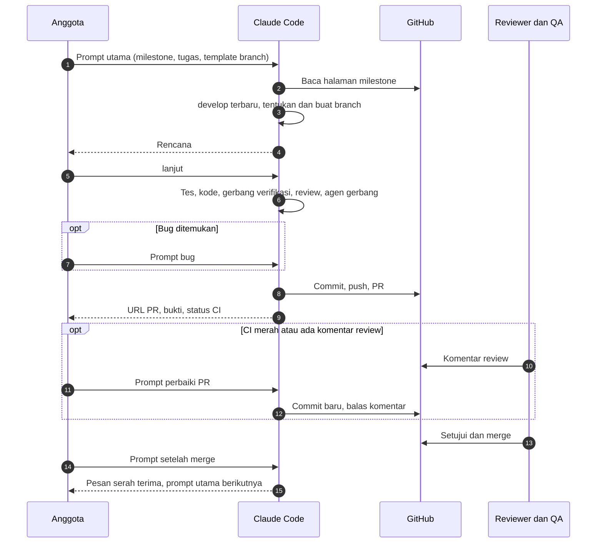

[Profil organisasi](https://github.com/DraftAja) · [Panduan kerja dengan agen AI](kerja-dengan-agen-ai.md) · [Semua milestone](../milestone/README.md) · [Serah terima](../serah-terima/README.md)

# Prompt siap pakai untuk Claude Code, Codex, dan Antigravity

Satu prompt utama untuk satu tugas, dari menyiapkan branch sampai PR. Kamu hanya mengganti tiga baris di atasnya: milestone, tugas, dan template branch. Nama branch ditentukan Claude dari template itu, dan rincian tugas diambil Claude sendiri dari [halaman milestone](../milestone/README.md).

Untuk keadaan di luar alur normal, misalnya bug, PR yang perlu diperbaiki, atau melanjutkan besok, ada [prompt pendek](#prompt-untuk-kasus-lain) di bawahnya.

## Sebelum mulai

- [Persiapan sekali per anggota](kerja-dengan-agen-ai.md#persiapan-sekali-per-anggota) sudah selesai, dan `gh auth status` menunjukkan sudah login.
- Alat AI (Claude Code, Codex, atau Antigravity) dibuka dari dalam folder repo yang dikerjakan. Prompt di halaman ini berlaku untuk ketiganya. Perbedaan cara memanggil agen dan review ada di [panduan](kerja-dengan-agen-ai.md#memakai-codex-dan-antigravity).
- Skill proyek sudah dipasang dengan skrip instal skill ([persiapan](kerja-dengan-agen-ai.md#persiapan-sekali-per-anggota)).
- Satu tugas, satu sesi. Ketik `/clear` sebelum memulai tugas berikutnya.

## Prompt utama

Ganti tiga baris teratas, lalu tempel. Isi "Tugas" dengan ID butir dari halaman milestone (`BE-01`, `FE-12`, `KF-AI-05`), atau tulis tugasnya dengan kalimat sendiri bila belum punya ID.

```text
Milestone: CORE-1
Tugas: BE-01
Template branch: <tipe>/<alias>-<milestone>-<deskripsi>

Kerjakan tugas di atas dari awal sampai PR. Ikuti AGENTS.md dan CLAUDE.md repo ini.

1. Persiapan
   - Jalankan git status. Bila ada perubahan yang belum di-commit, berhenti dan tanya saya.
   - Pastikan repo cocok dengan milestone: CORE dan AI di Backend-Laravel, WEB di Frontend-Nextjs, QA dan PM bisa di keduanya.
   - git fetch origin, git switch develop, git pull --ff-only origin develop.
   - Tentukan nama branch dari template. tipe: feat, fix, docs, test, refactor, atau chore sesuai isi tugas. alias: pemilik milestone (CORE = be-core, AI = be-ai, WEB = fe, QA = qa, PM = pm). milestone: huruf kecil tanpa strip, misalnya core1. deskripsi: 2 sampai 4 kata dari tugas, huruf kecil dipisah strip.
   - Bila branch itu sudah ada di lokal atau di origin, pindah ke sana dan lanjutkan dari keadaannya. Bila belum, buat dari develop.

2. Baca tugas
   - Ambil halaman milestone: gh api repos/DraftAja/.github/contents/milestone/<Milestone>.md -H "Accept: application/vnd.github.raw"
   - Rincian butir dan kriteria terimanya adalah definisi selesai. Periksa juga "Mulai setelah" dan serah terima yang masuk ke milestone ini.
   - Baca doc dan tes terkait di repo ini (backend: docs/18, docs/12, docs/05, docs/17; web: docs/03, docs/04, docs/06). Bila kode sekarang berbeda dari yang ditulis di halaman milestone, laporkan dengan berkas:baris.
   - Di repo web, bila tugas butuh endpoint baru: pastikan PR API-nya sudah merge, ambil docs/api/openapi.json dari origin/develop checkout API di sebelah repo ini, jalankan npm run api:sync dengan OPENAPI_SOURCE ke berkas itu, lalu npm run api:types.

3. Rencana, lalu berhenti
   - Tulis nama branch, berkas yang diubah, tes yang ditambah, doc yang disinkronkan, agen yang dipakai, risiko, dan pertanyaan.
   - Bila kontrak API berubah, tulis proposal dengan template doc 17 repo API dan berhenti sampai label kontrak-disetujui dipasang.
   - Tunggu saya membalas "lanjut" atau memberi koreksi.

4. Kerjakan
   - Untuk bug atau perubahan perilaku, tulis tes yang gagal lebih dulu.
   - Delegasikan ke agen pembangun tim saya bila membantu.
   - Berhenti dan tanya bila harus keluar dari rencana: berkas milik peran lain, migration yang sudah merge, dependensi, workflow CI, kontrak v1, atau hard rules di AGENTS.md.

5. Periksa
   - Jalankan gerbang verifikasi dari AGENTS.md sampai lolos.
   - Jalankan /code-review. Bila menyentuh auth, sesi, unggah berkas, proxy, HTML dari pengguna atau AI, atau provider AI, jalankan juga /security-review.
   - Kirim diff dan keluaran perintah ke agen gerbang tim saya. Perbaiki temuan yang wajib.
   - Buat tabel kriteria terima dan buktinya (nama tes, berkas:baris, keluaran perintah).
   - Pastikan tidak ada .env, kunci, token, dokumen asli, atau berkas di luar rencana.
   - Bila masih ada temuan wajib atau kriteria tanpa bukti, berhenti di sini dan laporkan.

6. Kirim
   - Saya mengizinkan commit, push ke branch ini, dan PR ke develop setelah langkah 5 bersih.
   - Commit dengan Conventional Commits. Judul menyebut ID milestone, misalnya fix(export): izinkan ekspor dokumen final (CORE-1). Badan menyebut ID butir dan temuan.
   - git push -u origin HEAD, tanpa force push.
   - gh pr create --base develop dengan isi template PR repo: ringkasan, tautan halaman milestone, tabel bukti, langkah yang belum dijalankan, doc yang berubah, PR pasangan bila ada.
   - Bila openapi.json berubah, pasang label butuh-fe bila label itu ada.
   - Tunggu gh pr checks selesai.

7. Laporkan URL PR, status CI, perintah yang dijalankan dan hasilnya, langkah yang belum dijalankan dan alasannya, doc yang berubah, dan serah terima yang perlu saya kirim.
```

Claude berhenti di dua keadaan saja: setelah menulis rencana (langkah 3), dan bila ada sesuatu yang harus kamu putuskan. Balas "lanjut" bila rencana benar, atau tulis koreksinya.

## Prompt untuk kasus lain

| Keadaan | Prompt |
|---|---|
| Ada bug, dari pengerjaan sendiri atau dari issue | [Bug](#bug) |
| Membuka lagi tugas yang belum selesai | [Lanjutkan](#lanjutkan) |
| CI di PR merah, atau reviewer meminta perubahan | [Perbaiki PR](#perbaiki-pr) |
| PR sudah merge | [Setelah merge](#setelah-merge) |
| Mengecek milestone, keamanan, atau kecocokan doc | [Audit](#audit) |

### Bug

```text
Bug: <gejala, langkah ulang, dan yang seharusnya; atau issue #nomor>

Bila bug ini bagian dari tugas di branch ini: reproduksi, tulis tes yang gagal, cari akar masalah dengan bukti berkas:baris, perbaiki, lalu lanjutkan langkah 5 sampai 7 prompt utama.
Bila di luar tugas ini: jangan perbaiki di sini. Tulis draf issue dengan template Laporan bug dan prompt utama yang sudah terisi untuk memperbaikinya, lalu tanya saya.
```

### Lanjutkan

```text
Lanjutkan tugas di branch ini. Baca git status, git log develop..HEAD, PR bila ada, dan halaman milestone dari nama branch. Ringkas posisinya, lalu teruskan prompt utama dari langkah yang belum selesai.
Bila develop sudah maju, perbarui branch: rebase bila belum pernah di-push, merge bila sudah. Berhenti bila ada konflik.
```

Bila sesi lama masih terbuka, `claude --continue` cukup tanpa prompt ini.

### Perbaiki PR

```text
PR #<nomor> perlu diperbaiki. Saya mengizinkan commit dan push ke branch ini.

Ambil log job CI yang gagal dan semua komentar review. Perbaiki yang disebabkan perubahan ini dan masih termasuk tugas. Kegagalan yang juga merah di develop, atau permintaan di luar tugas, cukup dicatat di PR.
Jangan menonaktifkan tes, menambah continue-on-error, atau force push. Jalankan gerbang verifikasi, buat commit baru, push, balas setiap komentar dengan hash commit-nya, lalu laporkan status CI.
```

### Setelah merge

```text
PR #<nomor> sudah merge. Perbarui develop, hapus branch ini di lokal (git branch -d) dan di origin.
Bila tugas ini membuka serah terima H<n>, tulis pesan serah terimanya sesuai halaman serah-terima/H<n>.md, tanpa kredensial. Bila openapi.json berubah, tulis pesan untuk pemilik FE.
Terakhir, tulis prompt utama yang sudah terisi untuk butir berikutnya di milestone ini.
```

Setelah itu ketik `/clear`, lalu tempel prompt utama yang dihasilkan.

### Audit

```text
Audit <milestone CORE-1 | keamanan branch ini | kecocokan doc area ekspor>. Hanya membaca, jangan mengubah apa pun.
Hasilnya tabel: temuan, tingkat (P0 menghambat atau membocorkan data, P1 sebelum feature freeze, P2 bila sempat, P3 kosmetik), bukti berkas:baris, pemilik, usulan perbaikan. Pisahkan temuan yang sudah tercatat di docs/18 atau docs/06.
Untuk temuan milik saya, tulis prompt utama yang sudah terisi.
```

## Alur



## Yang tetap perlu kamu lakukan

- **Baca rencana sebelum membalas "lanjut".** Mengoreksi rencana jauh lebih murah daripada mengoreksi diff.
- **Baca diff PR sebelum meminta review.** Agen gerbang hanya menilai bukti yang diberikan kepadanya.
- **Tagih bukti.** Bila laporan berisi "sudah dites" tanpa keluaran perintah, balas: "Tampilkan perintah yang dijalankan dan keluarannya."
- **Hentikan bila Claude melebar.** Tekan `Esc` lalu tulis koreksi. `/rewind` mengembalikan percakapan dan berkas ke titik sebelumnya.
- **Jangan menempel rahasia.** Isi `.env`, kunci API, token, kredensial, dan dokumen asli pengguna tidak masuk prompt.
- **Putuskan sendiri hal yang ditanyakan Claude.** Prompt ini tidak memberi izin untuk `migrate:fresh`, dependensi baru, perubahan workflow CI, atau berkas milik peran lain.

Bila satu prompt gagal dengan cara yang sama dua kali, perbaiki halaman ini supaya seluruh tim ikut memakai versi yang benar.
