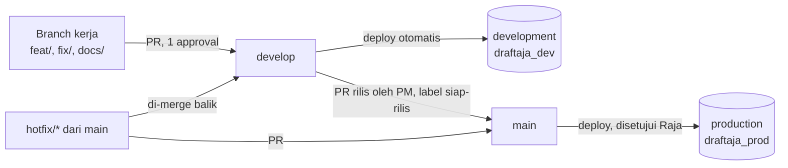
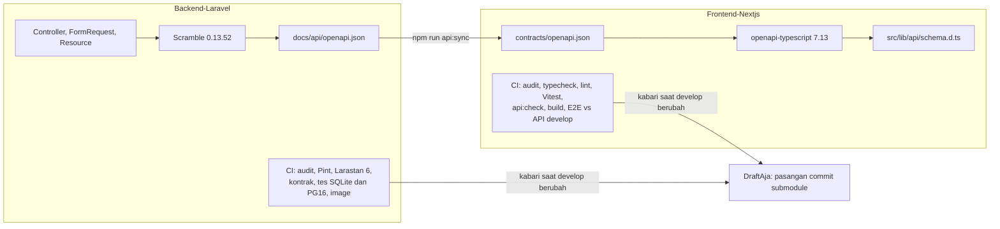

<div align="center">

# DraftAja

### Dari catatan mentah ke dokumen kantor yang rapi.

Layanan web untuk sekretaris, admin instansi, dan panitia kegiatan. Pilih template atau unggah contoh dokumen instansi, tempel catatan rapat apa adanya, lalu DraftAja menyusunnya mengikuti struktur dan gaya bahasa contoh tersebut. Hasilnya diunduh sebagai DOCX atau PDF.

<p>
  
  
  
  
  
  
</p>

<sub>Proyek mata kuliah Proyek TI, Telkom University. Tim 5 orang, 16 minggu.</sub>

</div>

---

## Daftar isi

1. [Repositori](#repositori)
2. [Tim dan peran](#tim-dan-peran)
3. [Kolaborasi: milestone, alur paralel, dan serah terima](#kolaborasi-milestone-alur-paralel-dan-serah-terima)
4. [Arsitektur sistem end-to-end](#arsitektur-sistem-end-to-end)
5. [Teknologi dan versi](#teknologi-dan-versi)
6. [Bekerja dengan agen AI dan tim agen](#bekerja-dengan-agen-ai-dan-tim-agen)
7. [Mulai di sini untuk anggota baru](#mulai-di-sini-untuk-anggota-baru)

> [!NOTE]
> Repo kode bersifat privat. Tautan bertanda 🔒 hanya bisa dibuka anggota organisasi yang sudah masuk ke GitHub. Ringkasan setiap milestone ditulis langsung di halaman ini agar bisa dibaca tanpa membuka berkas dokumentasi satu per satu.

## Repositori

| Repo | Isi | Pemilik utama | Development · Production |
|---|---|---|---|
| 🔒 [Backend-Laravel](https://github.com/DraftAja/Backend-Laravel) (draftaja-api) | API JSON `/api/v1`, aturan bisnis, data, antrean, AI, ekspor. Juga sumber spesifikasi produk di `docs/`. | `be-core`, `be-ai` | `develop` · `main` |
| 🔒 [Frontend-Nextjs](https://github.com/DraftAja/Frontend-Nextjs) (draftaja-web) | Semua halaman termasuk landing, proxy same-origin ke API, E2E Playwright. | `fe` | `develop` · `main` |
| 🔒 [DraftAja](https://github.com/DraftAja/DraftAja) | Repo gabungan. Mencatat pasangan commit `develop` kedua repo sebagai submodule. | `pm` | `main` |
| [.github](https://github.com/DraftAja/.github) | Profil organisasi ini dan template issue bawaan untuk semua repo. | `pm` | `main` |

Monolit Laravel + Inertia dipecah menjadi dua repo pada **3 November 2026**. Sejak itu backend dan frontend bisa dikerjakan paralel, dengan `openapi.json` sebagai kontrak di antara keduanya.

### Development dan production

Kedua repo kode punya dua lingkungan yang tidak pernah bercampur. Masing-masing punya branch, database, rahasia, dan templat konfigurasi sendiri.

| Lingkungan | Branch | Database | Yang masuk | Rahasia dan konfigurasi |
|---|---|---|---|---|
| development | `develop` | `draftaja_dev` | Semua PR dari branch kerja, kapan saja. QA menguji di sini. | GitHub Environment `development`, `deploy/development.env.example` |
| production | `main` | `draftaja_prod` | Hanya PR rilis dari `develop` oleh PM (setelah label `siap-rilis` dari QA) atau `hotfix/*` | GitHub Environment `production` dengan persetujuan Raja, `deploy/production.env.example` |



Workflow `Aturan branch` menolak PR ke `main` dari branch selain `develop` atau `hotfix/*`. API menolak start (`env:verify`) bila production menunjuk database development atau sebaliknya. Web development selalu memanggil API development, web production memanggil API production.

## Tim dan peran

| Anggota | Peran | Alias branch | Area | Dokumen yang dipegang |
|---|---|---|---|---|
| **Ahmad Raja Fadhil** ([@rajafadhil](https://github.com/rajafadhil)) | Project Manager | `pm` | Kontrak tim, konfigurasi repo, CI/CD, rilis dan tag, keputusan produk | API `docs/01`, `06`, `11` sampai `14`, `17`, `19`, `docs/adr/`, `TEAM_CONTRACT.md` |
| **M. Octafachdiansyah D.** ([@octafex](https://github.com/octafex)) | BE 1, modul inti | `be-core` | Auth, dokumen (laporan), template, ekspor, keamanan data | API `docs/04`, `05`, `07`, `18` (butir `be-core`) |
| **Abdurrahman Abdul Hamid** ([@abdhaamed](https://github.com/abdhaamed)) | BE 2, modul AI | `be-ai` | Pembelajaran pola, perapihan, generate dan chat, kuota AI | API `docs-ai/`, `docs/08`, `18` (butir `be-ai`) |
| **Alvira Risky** | Frontend | `fe` | Seluruh draftaja-web | web `docs/03` sampai `07` |
| **Louis Andreas** | QA | `qa` | Rencana uji, kasus negatif, E2E, laporan bug, tanda siap rilis | API `docs/16`, web `docs/07` |

BE 1 = `be-core` (Octaf) dan BE 2 = `be-ai` (Hamid), sesuai `TEAM_CONTRACT.md` v1.0.1 bagian 2, 3, 9, dan Lampiran A.

---

## Kolaborasi: milestone, alur paralel, dan serah terima

Semua pekerjaan kolaborasi berawal dari milestone. Setiap anggota memegang milestone di lajurnya sendiri, dan setiap milestone merujuk butir backlog yang sudah ditulis di dokumentasi kedua repo.

> [!IMPORTANT]
> **Kerja paralel, tanpa menunggu serah terima.**
> 1. Kerjakan milestone milikmu kapan saja. Urutan di diagram hanya saran.
> 2. Bila hasil anggota lain belum ada, pakai data contoh, tipe sementara, atau provider palsu.
> 3. Setelah butir atau milestone selesai, laporkan di issue GitHub dengan template **Laporan selesai** dan mention siapa yang perlu mereview. Lalu langsung lanjut.
> 4. Bila reviewer tidak setuju (label `perlu-perbaikan`), perbaiki lalu laporkan ulang di issue yang sama. Itu kembali ke langkah serah terima sebelumnya, bukan mulai dari awal.
>
> Rincian: [aturan serah terima](https://github.com/DraftAja/.github/blob/main/serah-terima/README.md#aturan-umum).

Backlog yang dirujuk milestone:

- Backlog backend `BE-01` sampai `BE-31` dan temuan `S-xx`: 🔒 [API doc 18](https://github.com/DraftAja/Backend-Laravel/blob/develop/docs/18-audit-pasca-split.md#backlog-backend)
- Backlog frontend `FE-01` sampai `FE-41`: 🔒 [web doc 06](https://github.com/DraftAja/Frontend-Nextjs/blob/develop/docs/06-backlog-frontend.md)
- Fase roadmap 0 sampai 5: 🔒 [API doc 10](https://github.com/DraftAja/Backend-Laravel/blob/develop/docs/10-project-status-and-gaps.md#roadmap)
- Kriteria rilis MVP: 🔒 [API doc 16](https://github.com/DraftAja/Backend-Laravel/blob/develop/docs/16-strategi-pengujian.md#kriteria-rilis-mvp)

### Jadwal besar

MVP adalah **fase 0 sampai 2** dan harus selesai sebelum feature freeze minggu 14. Fase 3 dan 4 dikerjakan bila kapasitas tersedia. Tanggal jatuh tempo setiap milestone diisi PM saat membuat GitHub Milestone di repo terkait.

| Fase | Tujuan | Milestone yang terlibat | Batas |
|---|---|---|---|
| 0 | Keamanan dan stabilisasi pasca-split | PM-1, CORE-1, CORE-2, AI-1, AI-2, WEB-1, WEB-2, QA-1, QA-2 | Sebelum fitur lain dibangun di atasnya |
| 1 | Penyelarasan persona: kategori, final dan revisi, kuota | PM-2, CORE-3, AI-3, WEB-3, QA-3 | Sebelum fase 2 |
| 2 | Katalog 64 template, kolom isian, regresi prompt | PM-3, CORE-4, CORE-5, AI-4, AI-5, WEB-4, WEB-5, QA-4, QA-5 | Feature freeze **minggu 14** |
| Rilis | MVP dibekukan, `v1.0-final`, pameran | PM-4, PM-5 | Minggu 14, 15, 16 |
| U | Dashboard usaha untuk UMKM: pencatatan, titip jual, invoice, lembar kerja, impor dan ekspor Excel, pengingat, add-on Multi-usaha, serta orientasi berdasarkan tujuan dengan menu sesuai pilihan | PM-6, CORE-6, CORE-7, AI-6, AI-7, WEB-6, WEB-7, QA-6, QA-7 | Bila kapasitas ada, boleh dimulai kapan saja. Sisa yang belum lulus di minggu 14 pindah ke fase 5. |
| 3 dan 4 | Ruang kerja instansi, tinjau dan penomoran | Ditambahkan sebagai milestone baru bila kapasitas ada | Setelah MVP |

### Diagram alur paralel

Lima kotak di atas adalah lima anggota yang bekerja beriringan. Garis yang turun dari setiap kotak adalah alur kerja orang itu, dibaca dari atas ke bawah. Urutan di garis adalah saran, bukan syarat: setiap orang boleh mengerjakan milestone di garisnya kapan saja.

| Tanda | Arti |
|---|---|
| 🏁 di atas garis | Titik milestone. Isi setiap milestone ada di [peta milestone](#peta-milestone). Milestone berikutnya boleh dimulai sebelum titik ini selesai. |
| Bingkai `par` "Bekerja bersamaan" | Milestone di dalamnya dikerjakan pada waktu yang sama oleh orang yang berbeda |
| Panah putus-putus mendatar | Serah terima berupa laporan: pengirim melapor di issue dan mention penerima sebagai reviewer. Penerima tidak menunggu panah ini untuk mulai. Labelnya `H<nomor> · <milestone pengirim> → <milestone penerima> · <isi>`, dan label yang sama persis ada di [tabel serah terima](#titik-serah-terima) |
| Blok berwarna | Fase roadmap. MVP adalah fase 0 sampai 2 |
| 🚩 | Gerbang rilis |

```mermaid
%%{init: {"sequence": {"noteAlign": "center"}}}%%
sequenceDiagram
    participant PM as Raja<br/>PM · pm
    participant CORE as Octaf<br/>BE 1 · be-core
    participant AI as Hamid<br/>BE 2 · be-ai
    participant WEB as Alvira<br/>FE · fe
    participant QA as Louis<br/>QA · qa

    rect rgba(245, 158, 11, 0.12)
        Note over PM,QA: FASE 0 · Keamanan dan stabilisasi pasca-split · mulai 3 Nov 2026
        par Bekerja bersamaan
            Note over PM: 🏁 PM-1<br/>Fondasi kolaborasi dua repo
        and
            Note over CORE: 🏁 CORE-1<br/>Keamanan fase 0
        and
            Note over WEB: 🏁 WEB-1<br/>Ketahanan tanpa menunggu API
        and
            Note over QA: 🏁 QA-1<br/>Rencana uji dan tinjauan kontrak
        end
        PM--)CORE: H1 · PM-1 → CORE-2 · kontrak tim v1.1, CODEOWNERS
        QA--)CORE: H2 · QA-1 → CORE-2 · kasus error inti disetujui
        QA--)AI: H3 · QA-1 → AI-1 · kasus error AI disetujui
        CORE--)QA: H4 · CORE-1 → QA-2 · fase 0 API siap uji
        WEB--)QA: H5 · WEB-1 → QA-2 · fase 0 web siap uji
        par Bekerja bersamaan
            Note over CORE: 🏁 CORE-2<br/>Kontrak error dan tipe respons
        and
            Note over AI: 🏁 AI-1<br/>Kontrak AI terketik
        and
            Note over QA: 🏁 QA-2<br/>Uji fase 0
        end
        CORE--)WEB: H6 · CORE-2 → WEB-2 · openapi.json inti baru
        AI--)WEB: H7 · AI-1 → WEB-2 · tipe generate, tidy, chat
        par Bekerja bersamaan
            Note over AI: 🏁 AI-2<br/>Provider palsu untuk E2E
        and
            Note over WEB: 🏁 WEB-2<br/>Sinkron kontrak baru
        end
        AI--)WEB: H8 · AI-2 → WEB-5 · stub provider untuk E2E
    end

    rect rgba(59, 130, 246, 0.12)
        Note over PM,QA: FASE 1 · Penyelarasan persona
        Note over PM: 🏁 PM-2<br/>Keputusan produk fase 1
        PM--)CORE: H9 · PM-2 → CORE-3 · kategori dan kolom identitas
        PM--)AI: H10 · PM-2 → AI-3 · persona asisten
        PM--)WEB: H11 · PM-2 → WEB-3 · teks kebijakan privasi
        par Bekerja bersamaan
            Note over CORE: 🏁 CORE-3<br/>Persona dan alur dokumen
        and
            Note over AI: 🏁 AI-3<br/>Persona asisten, kuota, proposal
        end
        CORE--)WEB: H12 · CORE-3 → WEB-3 · final, revisi, konflik
        AI--)WEB: H13 · AI-3 → WEB-3 · kuota dan proposal
        Note over WEB: 🏁 WEB-3<br/>Final, revisi, kuota, konflik
        WEB--)QA: H14 · WEB-3 → QA-3 · fase 1 siap uji
        Note over QA: 🏁 QA-3<br/>Uji fase 1
    end

    rect rgba(34, 197, 94, 0.12)
        Note over PM,QA: FASE 2 · Katalog 64 template · batas feature freeze minggu 14
        Note over PM: 🏁 PM-3<br/>Lingkungan uji nyata
        PM--)CORE: H15 · PM-3 → CORE-5 · PostgreSQL 16 sekali pakai
        PM--)AI: H16 · PM-3 → AI-4 · kunci Groq dan Gemini
        par Bekerja bersamaan
            Note over CORE: 🏁 CORE-4<br/>Katalog 64 template
        and
            Note over AI: 🏁 AI-4<br/>Uji provider sungguhan
        end
        CORE--)WEB: H17 · CORE-4 → WEB-4 · kategori dan kolom isian
        CORE--)QA: H18 · CORE-4 → QA-4 · 64 template di seeder
        par Bekerja bersamaan
            Note over CORE: 🏁 CORE-5<br/>Verifikasi PostgreSQL 16
        and
            Note over AI: 🏁 AI-5<br/>Regresi prompt nol fakta tambahan
        and
            Note over WEB: 🏁 WEB-4<br/>Katalog 8 kategori dan kolom isian
        end
        AI--)QA: H19 · AI-5 → QA-4 · hasil regresi prompt
        par Bekerja bersamaan
            Note over WEB: 🏁 WEB-5<br/>E2E MVP dan aksesibilitas
        and
            Note over QA: 🏁 QA-4<br/>Uji katalog dan regresi prompt
        end
        WEB--)QA: H20 · WEB-5 → QA-5 · E2E MVP hijau
        CORE--)PM: H21 · CORE-5 → PM-4 · hasil tes PostgreSQL 16
        Note over QA: 🏁 QA-5<br/>Gerbang rilis MVP
        QA--)PM: H22 · QA-5 → PM-4 · label siap-rilis
    end

    rect rgba(168, 85, 247, 0.12)
        Note over PM,QA: FASE U · Dashboard usaha · bila kapasitas, tidak menggeser minggu 14
        par Bekerja bersamaan
            Note over PM: 🏁 PM-6<br/>Keputusan produk Dashboard Usaha
        and
            Note over QA: 🏁 QA-6<br/>Rencana uji dan lembar hitung Fase U
        end
        PM--)CORE: H23 · PM-6 → CORE-6 · ADR usaha dan batas add-on
        PM--)AI: H24 · PM-6 → AI-6 · ADR 0008 dan dependensi disetujui
        QA--)CORE: H25 · QA-6 → CORE-6 · kasus uji rumus disetujui
        QA--)AI: H26 · QA-6 → AI-6 · kasus uji impor dan ekspor disetujui
        Note over CORE: 🏁 CORE-6<br/>Usaha, uang, dan stok
        CORE--)WEB: H27 · CORE-6 → WEB-6 · openapi usaha, uang, stok
        CORE--)AI: H28 · CORE-6 → AI-6 · service uang dan stok
        par Bekerja bersamaan
            Note over CORE: 🏁 CORE-7<br/>Mitra, titip jual, dan invoice
        and
            Note over AI: 🏁 AI-6<br/>Lembar kerja, impor, dan ekspor
        and
            Note over WEB: 🏁 WEB-6<br/>Kerangka Dashboard Usaha
        end
        CORE--)WEB: H29 · CORE-7 → WEB-7 · openapi mitra dan invoice
        CORE--)AI: H30 · CORE-7 → AI-7 · data invoice untuk rekap dan pengingat
        AI--)WEB: H31 · AI-6 → WEB-7 · openapi lembar kerja, impor, ekspor
        Note over AI: 🏁 AI-7<br/>Ringkasan, teks ke tabel, dan pengingat
        AI--)WEB: H32 · AI-7 → WEB-7 · openapi ringkasan, teks ke tabel, pengingat
        AI--)QA: H33 · AI-7 → QA-7 · hasil regresi prompt teks ke tabel
        Note over WEB: 🏁 WEB-7<br/>Mitra, invoice, lembar kerja, dan impor
        WEB--)QA: H34 · WEB-7 → QA-7 · Fase U siap uji
        Note over QA: 🏁 QA-7<br/>Uji dan gerbang Fase U
        QA--)PM: H35 · QA-7 → PM-4 · label siap-rilis Fase U
    end

    rect rgba(239, 68, 68, 0.12)
        Note over PM,QA: RILIS
        Note over PM: 🚩 PM-4<br/>Feature freeze dan rilis MVP, minggu 14
        Note over PM,QA: Setelah minggu 14 hanya perbaikan bug dan dokumentasi
        Note over PM: 🚩 PM-5<br/>v1.0-final minggu 15, pameran minggu 16
    end
```



### Peta milestone

Tabel ini mengikuti lajur di diagram: satu kolom per anggota, satu baris per fase. Klik nomor milestone untuk membuka halamannya, berisi tujuan, butir pekerjaan beserta kriteria terima, dan rincian setiap butir: masalah di kode sekarang, langkah pengerjaan, bukti selesai, dan hal yang perlu dihindari. Halaman itu bisa dibaca tanpa membuka dokumentasi di repo privat. Semua halaman juga ada di [folder milestone](https://github.com/DraftAja/.github/tree/main/milestone).

| Fase | Raja · PM | Octaf · BE 1 | Hamid · BE 2 | Alvira · FE | Louis · QA |
|---|---|---|---|---|---|
| Fase 0 · Keamanan dan stabilisasi pasca-split | [PM-1](https://github.com/DraftAja/.github/blob/main/milestone/PM-1.md) Fondasi kolaborasi dua repo | [CORE-1](https://github.com/DraftAja/.github/blob/main/milestone/CORE-1.md) Keamanan fase 0<br>[CORE-2](https://github.com/DraftAja/.github/blob/main/milestone/CORE-2.md) Kontrak error dan tipe respons | [AI-1](https://github.com/DraftAja/.github/blob/main/milestone/AI-1.md) Kontrak AI terketik<br>[AI-2](https://github.com/DraftAja/.github/blob/main/milestone/AI-2.md) Provider palsu untuk E2E | [WEB-1](https://github.com/DraftAja/.github/blob/main/milestone/WEB-1.md) Ketahanan tanpa menunggu API<br>[WEB-2](https://github.com/DraftAja/.github/blob/main/milestone/WEB-2.md) Sinkron kontrak baru | [QA-1](https://github.com/DraftAja/.github/blob/main/milestone/QA-1.md) Rencana uji dan tinjauan kontrak<br>[QA-2](https://github.com/DraftAja/.github/blob/main/milestone/QA-2.md) Uji fase 0 |
| Fase 1 · Penyelarasan persona | [PM-2](https://github.com/DraftAja/.github/blob/main/milestone/PM-2.md) Keputusan produk fase 1 | [CORE-3](https://github.com/DraftAja/.github/blob/main/milestone/CORE-3.md) Persona dan alur dokumen | [AI-3](https://github.com/DraftAja/.github/blob/main/milestone/AI-3.md) Persona asisten, kuota, proposal | [WEB-3](https://github.com/DraftAja/.github/blob/main/milestone/WEB-3.md) Final, revisi, kuota, konflik | [QA-3](https://github.com/DraftAja/.github/blob/main/milestone/QA-3.md) Uji fase 1 |
| Fase 2 · Katalog 64 template | [PM-3](https://github.com/DraftAja/.github/blob/main/milestone/PM-3.md) Lingkungan uji nyata | [CORE-4](https://github.com/DraftAja/.github/blob/main/milestone/CORE-4.md) Katalog 64 template<br>[CORE-5](https://github.com/DraftAja/.github/blob/main/milestone/CORE-5.md) Verifikasi PostgreSQL 16 | [AI-4](https://github.com/DraftAja/.github/blob/main/milestone/AI-4.md) Uji provider sungguhan<br>[AI-5](https://github.com/DraftAja/.github/blob/main/milestone/AI-5.md) Regresi prompt nol fakta tambahan | [WEB-4](https://github.com/DraftAja/.github/blob/main/milestone/WEB-4.md) Katalog 8 kategori dan kolom isian<br>[WEB-5](https://github.com/DraftAja/.github/blob/main/milestone/WEB-5.md) E2E MVP dan aksesibilitas | [QA-4](https://github.com/DraftAja/.github/blob/main/milestone/QA-4.md) Uji katalog dan regresi prompt<br>[QA-5](https://github.com/DraftAja/.github/blob/main/milestone/QA-5.md) Gerbang rilis MVP |
| Fase U · Dashboard usaha (bila kapasitas) | [PM-6](https://github.com/DraftAja/.github/blob/main/milestone/PM-6.md) Keputusan produk Dashboard Usaha | [CORE-6](https://github.com/DraftAja/.github/blob/main/milestone/CORE-6.md) Usaha, uang, dan stok<br>[CORE-7](https://github.com/DraftAja/.github/blob/main/milestone/CORE-7.md) Mitra, titip jual, dan invoice | [AI-6](https://github.com/DraftAja/.github/blob/main/milestone/AI-6.md) Lembar kerja, impor, dan ekspor<br>[AI-7](https://github.com/DraftAja/.github/blob/main/milestone/AI-7.md) Ringkasan, teks ke tabel, dan pengingat | [WEB-6](https://github.com/DraftAja/.github/blob/main/milestone/WEB-6.md) Kerangka Dashboard Usaha<br>[WEB-7](https://github.com/DraftAja/.github/blob/main/milestone/WEB-7.md) Mitra, invoice, lembar kerja, dan impor | [QA-6](https://github.com/DraftAja/.github/blob/main/milestone/QA-6.md) Rencana uji dan lembar hitung Fase U<br>[QA-7](https://github.com/DraftAja/.github/blob/main/milestone/QA-7.md) Uji dan gerbang Fase U |
| Rilis · minggu 14, 15, 16 | [PM-4](https://github.com/DraftAja/.github/blob/main/milestone/PM-4.md) Feature freeze dan rilis MVP, minggu 14<br>[PM-5](https://github.com/DraftAja/.github/blob/main/milestone/PM-5.md) v1.0-final minggu 15, pameran minggu 16 |   |   |   |   |

### Titik serah terima

Cara membaca: cari label panah di diagram, lalu cari label yang sama di tabel ini. Urutan baris sama dengan urutan panah dari atas ke bawah. Setiap serah terima adalah laporan di issue GitHub dengan mention ke penerima, bukan titik tunggu. Penerima mereview; bila tidak setuju, pengirim memperbaiki dan melapor ulang di issue yang sama. Klik label untuk membuka halaman serah terima: isi paket, syarat sebelum dikirim, cara melapor, cara penerima mereview, dan yang dikerjakan selama belum dilaporkan. Aturan umumnya ada di [folder serah terima](https://github.com/DraftAja/.github/tree/main/serah-terima).

#### Fase 0 · Keamanan dan stabilisasi pasca-split

| Label di diagram | Dari | Ke | Yang diserahkan | Kanal | Dipakai untuk |
|---|---|---|---|---|---|
| [**H1 · PM-1 → CORE-2 · kontrak tim v1.1, CODEOWNERS**](https://github.com/DraftAja/.github/blob/main/serah-terima/H1.md) | Raja (PM)<br>[PM-1](https://github.com/DraftAja/.github/blob/main/milestone/PM-1.md) | Octaf (BE 1)<br>[CORE-2](https://github.com/DraftAja/.github/blob/main/milestone/CORE-2.md) | `TEAM_CONTRACT.md` v1.1, CODEOWNERS per repo, branch protection, label. Berlaku untuk semua anggota. | PR ke `develop`, pengumuman di grup | Reviewer wajib sudah berlaku sebelum BE-03 mengubah kontrak error |
| [**H2 · QA-1 → CORE-2 · kasus error inti disetujui**](https://github.com/DraftAja/.github/blob/main/serah-terima/H2.md) | Louis (QA)<br>[QA-1](https://github.com/DraftAja/.github/blob/main/milestone/QA-1.md) | Octaf (BE 1)<br>[CORE-2](https://github.com/DraftAja/.github/blob/main/milestone/CORE-2.md) | Persetujuan daftar `code` error di proposal kontrak endpoint inti | Komentar di issue `kontrak`, label `kontrak-disetujui` | Menulis satu tes per `code` di BE-03 |
| [**H3 · QA-1 → AI-1 · kasus error AI disetujui**](https://github.com/DraftAja/.github/blob/main/serah-terima/H3.md) | Louis (QA)<br>[QA-1](https://github.com/DraftAja/.github/blob/main/milestone/QA-1.md) | Hamid (BE 2)<br>[AI-1](https://github.com/DraftAja/.github/blob/main/milestone/AI-1.md) | Persetujuan kasus error endpoint AI (generate, tidy, chat) | Komentar di issue `kontrak`, label `kontrak-disetujui` | Mengunci bentuk respons AI di BE-04 |
| [**H4 · CORE-1 → QA-2 · fase 0 API siap uji**](https://github.com/DraftAja/.github/blob/main/serah-terima/H4.md) | Octaf (BE 1)<br>[CORE-1](https://github.com/DraftAja/.github/blob/main/milestone/CORE-1.md) | Louis (QA)<br>[QA-2](https://github.com/DraftAja/.github/blob/main/milestone/QA-2.md) | PR BE-01, BE-02, BE-09, BE-17 yang sudah merge, beserta cara memicu setiap error | Daftar periksa serah terima QA di PR | Menguji kasus negatif fase 0 |
| [**H5 · WEB-1 → QA-2 · fase 0 web siap uji**](https://github.com/DraftAja/.github/blob/main/serah-terima/H5.md) | Alvira (FE)<br>[WEB-1](https://github.com/DraftAja/.github/blob/main/milestone/WEB-1.md) | Louis (QA)<br>[QA-2](https://github.com/DraftAja/.github/blob/main/milestone/QA-2.md) | Pasangan commit API dan web, tangkapan layar 360 px dan desktop | Daftar periksa serah terima QA di PR web | Menguji status tak dikenal, mode baca, zona waktu, pesan error |
| [**H6 · CORE-2 → WEB-2 · openapi.json inti baru**](https://github.com/DraftAja/.github/blob/main/serah-terima/H6.md) | Octaf (BE 1)<br>[CORE-2](https://github.com/DraftAja/.github/blob/main/milestone/CORE-2.md) | Alvira (FE)<br>[WEB-2](https://github.com/DraftAja/.github/blob/main/milestone/WEB-2.md) | `openapi.json` dengan skema `ErrorResponse` dan tipe respons dashboard, options, template | PR API merge, label `butuh-fe` di issue web | `npm run api:sync && npm run api:types`, lalu mengosongkan "Kontrak manual" |
| [**H7 · AI-1 → WEB-2 · tipe generate, tidy, chat**](https://github.com/DraftAja/.github/blob/main/serah-terima/H7.md) | Hamid (BE 2)<br>[AI-1](https://github.com/DraftAja/.github/blob/main/milestone/AI-1.md) | Alvira (FE)<br>[WEB-2](https://github.com/DraftAja/.github/blob/main/milestone/WEB-2.md) | Tipe `Generation`, `CleanupReservation`, `ChatReply` di `openapi.json` | PR API merge, label `butuh-fe` di issue web | FE-08 tanpa tipe tulisan tangan |
| [**H8 · AI-2 → WEB-5 · stub provider untuk E2E**](https://github.com/DraftAja/.github/blob/main/serah-terima/H8.md) | Hamid (BE 2)<br>[AI-2](https://github.com/DraftAja/.github/blob/main/milestone/AI-2.md) | Alvira (FE)<br>[WEB-5](https://github.com/DraftAja/.github/blob/main/milestone/WEB-5.md) | Cara mengarahkan `AI_*` ke provider palsu lokal, tertulis di doc 09 API. Juga dipakai Louis. | Issue kesepakatan `be-ai` dan `fe` | E2E perapihan tanpa kunci sungguhan (FE-23) |

#### Fase 1 · Penyelarasan persona

| Label di diagram | Dari | Ke | Yang diserahkan | Kanal | Dipakai untuk |
|---|---|---|---|---|---|
| [**H9 · PM-2 → CORE-3 · kategori dan kolom identitas**](https://github.com/DraftAja/.github/blob/main/serah-terima/H9.md) | Raja (PM)<br>[PM-2](https://github.com/DraftAja/.github/blob/main/milestone/PM-2.md) | Octaf (BE 1)<br>[CORE-3](https://github.com/DraftAja/.github/blob/main/milestone/CORE-3.md) | Keputusan 8 kunci kategori, pemetaan nilai lama, dan kolom identitas pengganti kolom akademik | Issue keputusan ditutup, doc 12 diperbarui | Enum `DocumentCategory` dan migrasi kolom (KF-DOK-04) |
| [**H10 · PM-2 → AI-3 · persona asisten**](https://github.com/DraftAja/.github/blob/main/serah-terima/H10.md) | Raja (PM)<br>[PM-2](https://github.com/DraftAja/.github/blob/main/milestone/PM-2.md) | Hamid (BE 2)<br>[AI-3](https://github.com/DraftAja/.github/blob/main/milestone/AI-3.md) | Persona dan batas asisten DraftAja | Issue keputusan ditutup, doc 01 atau 11 diperbarui | Mengganti prompt "LaporBot" (KF-AI-05) |
| [**H11 · PM-2 → WEB-3 · teks kebijakan privasi**](https://github.com/DraftAja/.github/blob/main/serah-terima/H11.md) | Raja (PM)<br>[PM-2](https://github.com/DraftAja/.github/blob/main/milestone/PM-2.md) | Alvira (FE)<br>[WEB-3](https://github.com/DraftAja/.github/blob/main/milestone/WEB-3.md) | Isi halaman kebijakan privasi | Issue keputusan ditutup | Halaman `/kebijakan-privasi` (FE-15) |
| [**H12 · CORE-3 → WEB-3 · final, revisi, konflik**](https://github.com/DraftAja/.github/blob/main/serah-terima/H12.md) | Octaf (BE 1)<br>[CORE-3](https://github.com/DraftAja/.github/blob/main/milestone/CORE-3.md) | Alvira (FE)<br>[WEB-3](https://github.com/DraftAja/.github/blob/main/milestone/WEB-3.md) | `POST /laporan/{id}/finalize`, `POST /laporan/{id}/revisions`, 409 `revision_changed` | PR API merge, label `butuh-fe` di issue web | FE-12 tombol final dan revisi, FE-14 dialog konflik |
| [**H13 · AI-3 → WEB-3 · kuota dan proposal**](https://github.com/DraftAja/.github/blob/main/serah-terima/H13.md) | Hamid (BE 2)<br>[AI-3](https://github.com/DraftAja/.github/blob/main/milestone/AI-3.md) | Alvira (FE)<br>[WEB-3](https://github.com/DraftAja/.github/blob/main/milestone/WEB-3.md) | `GET /ai/quota` dan field `proposal` berbentuk objek | PR API merge, label `butuh-fe` di issue web | FE-13 kartu kuota, FE-18 tanpa `JSON.parse` |
| [**H14 · WEB-3 → QA-3 · fase 1 siap uji**](https://github.com/DraftAja/.github/blob/main/serah-terima/H14.md) | Alvira (FE)<br>[WEB-3](https://github.com/DraftAja/.github/blob/main/milestone/WEB-3.md) | Louis (QA)<br>[QA-3](https://github.com/DraftAja/.github/blob/main/milestone/QA-3.md) | Fase 1 lengkap di kedua repo: PR web merujuk PR API yang sudah merge | Repo gabungan mencatat pasangan commit, daftar periksa serah terima QA | Menguji transisi status, persona, ekspor per kategori |

#### Fase 2 · Katalog 64 template

| Label di diagram | Dari | Ke | Yang diserahkan | Kanal | Dipakai untuk |
|---|---|---|---|---|---|
| [**H15 · PM-3 → CORE-5 · PostgreSQL 16 sekali pakai**](https://github.com/DraftAja/.github/blob/main/serah-terima/H15.md) | Raja (PM)<br>[PM-3](https://github.com/DraftAja/.github/blob/main/milestone/PM-3.md) | Octaf (BE 1)<br>[CORE-5](https://github.com/DraftAja/.github/blob/main/milestone/CORE-5.md) | Instance PostgreSQL 16 sekali pakai (bukan database Azure bersama) dan izin pemakaiannya | Kanal aman, bukan repo | Tes konkurensi, migrasi, upgrade, schema check |
| [**H16 · PM-3 → AI-4 · kunci Groq dan Gemini**](https://github.com/DraftAja/.github/blob/main/serah-terima/H16.md) | Raja (PM)<br>[PM-3](https://github.com/DraftAja/.github/blob/main/milestone/PM-3.md) | Hamid (BE 2)<br>[AI-4](https://github.com/DraftAja/.github/blob/main/milestone/AI-4.md) | Kunci Groq dan Gemini, izin pemakaian terbatas, nama `GEMINI_MODEL` yang aktif | Kanal aman, bukan chat grup terbuka | Smoke test provider dan regresi prompt |
| [**H17 · CORE-4 → WEB-4 · kategori dan kolom isian**](https://github.com/DraftAja/.github/blob/main/serah-terima/H17.md) | Octaf (BE 1)<br>[CORE-4](https://github.com/DraftAja/.github/blob/main/milestone/CORE-4.md) | Alvira (FE)<br>[WEB-4](https://github.com/DraftAja/.github/blob/main/milestone/WEB-4.md) | `GET /categories`, `template_fields`, `laporans.field_values` di `openapi.json` | PR API merge, label `butuh-fe` di issue web | FE-17 katalog dan kolom isian |
| [**H18 · CORE-4 → QA-4 · 64 template di seeder**](https://github.com/DraftAja/.github/blob/main/serah-terima/H18.md) | Octaf (BE 1)<br>[CORE-4](https://github.com/DraftAja/.github/blob/main/milestone/CORE-4.md) | Louis (QA)<br>[QA-4](https://github.com/DraftAja/.github/blob/main/milestone/QA-4.md) | 64 template di `TemplateSeeder` sesuai `docs/templates/` | PR API merge | Memeriksa kesesuaian spesifikasi dan seeder |
| [**H19 · AI-5 → QA-4 · hasil regresi prompt**](https://github.com/DraftAja/.github/blob/main/serah-terima/H19.md) | Hamid (BE 2)<br>[AI-5](https://github.com/DraftAja/.github/blob/main/milestone/AI-5.md) | Louis (QA)<br>[QA-4](https://github.com/DraftAja/.github/blob/main/milestone/QA-4.md) | Keluaran minimal 10 pasang catatan untuk Groq dan Gemini | Dicatat di doc 10 dan `docs-ai/07-testing.md` | Pemeriksaan manual fakta tambahan dan penanda `[perlu dilengkapi]` |
| [**H20 · WEB-5 → QA-5 · E2E MVP hijau**](https://github.com/DraftAja/.github/blob/main/serah-terima/H20.md) | Alvira (FE)<br>[WEB-5](https://github.com/DraftAja/.github/blob/main/milestone/WEB-5.md) | Louis (QA)<br>[QA-5](https://github.com/DraftAja/.github/blob/main/milestone/QA-5.md) | E2E P1 dan "P2 bagian template" lulus di 360 px dan 1440 px | CI web hijau di `develop` | Kriteria rilis butir 5 |
| [**H21 · CORE-5 → PM-4 · hasil tes PostgreSQL 16**](https://github.com/DraftAja/.github/blob/main/serah-terima/H21.md) | Octaf (BE 1)<br>[CORE-5](https://github.com/DraftAja/.github/blob/main/milestone/CORE-5.md) | Raja (PM)<br>[PM-4](https://github.com/DraftAja/.github/blob/main/milestone/PM-4.md) | Hasil seluruh rangkaian tes di PostgreSQL 16 | Doc 10 bagian verifikasi | Kriteria rilis butir 1 |
| [**H22 · QA-5 → PM-4 · label siap-rilis**](https://github.com/DraftAja/.github/blob/main/serah-terima/H22.md) | Louis (QA)<br>[QA-5](https://github.com/DraftAja/.github/blob/main/milestone/QA-5.md) | Raja (PM)<br>[PM-4](https://github.com/DraftAja/.github/blob/main/milestone/PM-4.md) | Label `siap-rilis` pada pasangan commit API dan web | Issue di repo gabungan DraftAja | Membuat `release/*` dan tag pasangan versi |

#### Fase U · Dashboard usaha

| Label di diagram | Dari | Ke | Yang diserahkan | Kanal | Dipakai untuk |
|---|---|---|---|---|---|
| [**H23 · PM-6 → CORE-6 · ADR usaha dan batas add-on**](https://github.com/DraftAja/.github/blob/main/serah-terima/H23.md) | Raja (PM)<br>[PM-6](https://github.com/DraftAja/.github/blob/main/milestone/PM-6.md) | Octaf (BE 1)<br>[CORE-6](https://github.com/DraftAja/.github/blob/main/milestone/CORE-6.md) | ADR 0007 Diterima, angka batas usaha untuk akun uji coba, cara admin mengaktifkan add-on | PR docs merge, pengumuman di grup | BE-19 usaha dan `PlanLimits::maxBusinesses()` |
| [**H24 · PM-6 → AI-6 · ADR 0008 dan dependensi disetujui**](https://github.com/DraftAja/.github/blob/main/serah-terima/H24.md) | Raja (PM)<br>[PM-6](https://github.com/DraftAja/.github/blob/main/milestone/PM-6.md) | Hamid (BE 2)<br>[AI-6](https://github.com/DraftAja/.github/blob/main/milestone/AI-6.md) | ADR 0008 Diterima, izin PhpSpreadsheet dan TanStack Table. Juga berlaku untuk Alvira (WEB-7). | PR docs merge, pengumuman di grup | BE-26, BE-27, FE-35 |
| [**H25 · QA-6 → CORE-6 · kasus uji rumus disetujui**](https://github.com/DraftAja/.github/blob/main/serah-terima/H25.md) | Louis (QA)<br>[QA-6](https://github.com/DraftAja/.github/blob/main/milestone/QA-6.md) | Octaf (BE 1)<br>[CORE-6](https://github.com/DraftAja/.github/blob/main/milestone/CORE-6.md) | Lembar hitung manual U01 sampai U17 yang cocok dengan doc 21 | Komentar di issue `kontrak`, label `kontrak-disetujui` | Tes rumus BE-20 sampai BE-23 |
| [**H26 · QA-6 → AI-6 · kasus uji impor dan ekspor disetujui**](https://github.com/DraftAja/.github/blob/main/serah-terima/H26.md) | Louis (QA)<br>[QA-6](https://github.com/DraftAja/.github/blob/main/milestone/QA-6.md) | Hamid (BE 2)<br>[AI-6](https://github.com/DraftAja/.github/blob/main/milestone/AI-6.md) | Daftar berkas uji impor dan pemeriksaan ekspor beserta hasil yang diharapkan | Komentar di issue `kontrak`, label `kontrak-disetujui` | Tes BE-26 dan BE-27 |
| [**H27 · CORE-6 → WEB-6 · openapi usaha, uang, stok**](https://github.com/DraftAja/.github/blob/main/serah-terima/H27.md) | Octaf (BE 1)<br>[CORE-6](https://github.com/DraftAja/.github/blob/main/milestone/CORE-6.md) | Alvira (FE)<br>[WEB-6](https://github.com/DraftAja/.github/blob/main/milestone/WEB-6.md) | `openapi.json` dengan endpoint usaha, uang, dan stok (BE-19 sampai BE-21) | PR API merge, label `butuh-fe` di issue web | FE-28, FE-30, FE-31, FE-32 |
| [**H28 · CORE-6 → AI-6 · service uang dan stok**](https://github.com/DraftAja/.github/blob/main/serah-terima/H28.md) | Octaf (BE 1)<br>[CORE-6](https://github.com/DraftAja/.github/blob/main/milestone/CORE-6.md) | Hamid (BE 2)<br>[AI-6](https://github.com/DraftAja/.github/blob/main/milestone/AI-6.md) | Service uang dan mutasi stok yang dipanggil lembar kerja dan impor | PR API merge, issue kesepakatan `be-core` dan `be-ai` | BE-25 lembar bertipe, BE-26 commit impor |
| [**H29 · CORE-7 → WEB-7 · openapi mitra dan invoice**](https://github.com/DraftAja/.github/blob/main/serah-terima/H29.md) | Octaf (BE 1)<br>[CORE-7](https://github.com/DraftAja/.github/blob/main/milestone/CORE-7.md) | Alvira (FE)<br>[WEB-7](https://github.com/DraftAja/.github/blob/main/milestone/WEB-7.md) | `openapi.json` dengan endpoint mitra, titip jual, dan invoice (BE-22 sampai BE-24) | PR API merge, label `butuh-fe` di issue web | FE-33, FE-34 |
| [**H30 · CORE-7 → AI-7 · data invoice untuk rekap dan pengingat**](https://github.com/DraftAja/.github/blob/main/serah-terima/H30.md) | Octaf (BE 1)<br>[CORE-7](https://github.com/DraftAja/.github/blob/main/milestone/CORE-7.md) | Hamid (BE 2)<br>[AI-7](https://github.com/DraftAja/.github/blob/main/milestone/AI-7.md) | Service `BusinessFigures` dan status invoice | PR API merge, issue kesepakatan `be-core` dan `be-ai` | BE-28 rekap, pengingat invoice di BE-30 |
| [**H31 · AI-6 → WEB-7 · openapi lembar kerja, impor, ekspor**](https://github.com/DraftAja/.github/blob/main/serah-terima/H31.md) | Hamid (BE 2)<br>[AI-6](https://github.com/DraftAja/.github/blob/main/milestone/AI-6.md) | Alvira (FE)<br>[WEB-7](https://github.com/DraftAja/.github/blob/main/milestone/WEB-7.md) | `openapi.json` dengan endpoint lembar kerja, impor, dan ekspor (BE-25 sampai BE-27) | PR API merge, label `butuh-fe` di issue web | FE-35, FE-36 |
| [**H32 · AI-7 → WEB-7 · openapi ringkasan, teks ke tabel, pengingat**](https://github.com/DraftAja/.github/blob/main/serah-terima/H32.md) | Hamid (BE 2)<br>[AI-7](https://github.com/DraftAja/.github/blob/main/milestone/AI-7.md) | Alvira (FE)<br>[WEB-7](https://github.com/DraftAja/.github/blob/main/milestone/WEB-7.md) | `openapi.json` dengan endpoint ringkasan, rekap, teks ke tabel, dan pengingat (BE-28 sampai BE-30) | PR API merge, label `butuh-fe` di issue web | FE-29, FE-36, FE-37, FE-38 |
| [**H33 · AI-7 → QA-7 · hasil regresi prompt teks ke tabel**](https://github.com/DraftAja/.github/blob/main/serah-terima/H33.md) | Hamid (BE 2)<br>[AI-7](https://github.com/DraftAja/.github/blob/main/milestone/AI-7.md) | Louis (QA)<br>[QA-7](https://github.com/DraftAja/.github/blob/main/milestone/QA-7.md) | Keluaran minimal 10 teks untuk Groq dan Gemini, nol angka tambahan | Dicatat di doc 10 dan `docs-ai/07-testing.md` | Pemeriksaan manual angka tambahan |
| [**H34 · WEB-7 → QA-7 · Fase U siap uji**](https://github.com/DraftAja/.github/blob/main/serah-terima/H34.md) | Alvira (FE)<br>[WEB-7](https://github.com/DraftAja/.github/blob/main/milestone/WEB-7.md) | Louis (QA)<br>[QA-7](https://github.com/DraftAja/.github/blob/main/milestone/QA-7.md) | Pasangan commit API dan web dengan Fase U lengkap, tangkapan layar 360 px dan desktop | Repo gabungan mencatat pasangan commit, daftar periksa serah terima QA | Semua uji QA-7 |
| [**H35 · QA-7 → PM-4 · label siap-rilis Fase U**](https://github.com/DraftAja/.github/blob/main/serah-terima/H35.md) | Louis (QA)<br>[QA-7](https://github.com/DraftAja/.github/blob/main/milestone/QA-7.md) | Raja (PM)<br>[PM-4](https://github.com/DraftAja/.github/blob/main/milestone/PM-4.md) | Label `siap-rilis-fase-u`, atau daftar bagian yang pindah ke fase 5 | Issue di repo gabungan DraftAja | Keputusan isi rilis minggu 14 |

### Cara kerja

Nama branch memuat peran dan milestone yang sedang dikerjakan:

```text
<tipe>/<alias>-<milestone>-<deskripsi>
```

`<tipe>` salah satu dari `feat`, `fix`, `docs`, `test`, `refactor`, `chore`. `<milestone>` ditulis huruf kecil tanpa strip, misalnya `core1` atau `web3`.

| Peran | Alias | Milestone | Contoh branch |
|---|---|---|---|
| Raja · PM | `pm` | [PM-1](https://github.com/DraftAja/.github/blob/main/milestone/PM-1.md) sampai [PM-6](https://github.com/DraftAja/.github/blob/main/milestone/PM-6.md) | `docs/pm-pm1-kontrak-tim-v1.1` |
| Octaf · BE 1 | `be-core` | [CORE-1](https://github.com/DraftAja/.github/blob/main/milestone/CORE-1.md) sampai [CORE-7](https://github.com/DraftAja/.github/blob/main/milestone/CORE-7.md) | `fix/be-core-core1-policy-ekspor` |
| Hamid · BE 2 | `be-ai` | [AI-1](https://github.com/DraftAja/.github/blob/main/milestone/AI-1.md) sampai [AI-7](https://github.com/DraftAja/.github/blob/main/milestone/AI-7.md) | `feat/be-ai-ai1-tipe-respons` |
| Alvira · FE | `fe` | [WEB-1](https://github.com/DraftAja/.github/blob/main/milestone/WEB-1.md) sampai [WEB-7](https://github.com/DraftAja/.github/blob/main/milestone/WEB-7.md) | `fix/fe-web1-status-bawaan` |
| Louis · QA | `qa` | [QA-1](https://github.com/DraftAja/.github/blob/main/milestone/QA-1.md) sampai [QA-7](https://github.com/DraftAja/.github/blob/main/milestone/QA-7.md) | `docs/qa-qa1-rencana-uji` |

- Branch dibuat dari `develop`, PR kembali ke `develop` (development). Judul PR menyebut ID milestone, misalnya `feat(ai): tambah endpoint kuota (AI-3)`.
- `main` (production) hanya menerima PR rilis dari `develop` oleh PM, atau `hotfix/*`.
- Setelah PR merge, buka issue **Laporan selesai** dan mention reviewer. Jangan menunggu tanggapan untuk lanjut.
- Satu branch untuk satu butir pekerjaan. Contoh branch untuk setiap milestone ada di halaman milestone-nya.
- Template issue Tugas milestone, Proposal kontrak, Laporan bug, dan Laporan selesai tersedia otomatis di semua repo organisasi.

Aturan lengkap ada di 🔒 [`TEAM_CONTRACT.md`](https://github.com/DraftAja/Backend-Laravel/blob/develop/TEAM_CONTRACT.md) dan 🔒 [doc 17](https://github.com/DraftAja/Backend-Laravel/blob/develop/docs/17-kolaborasi-dan-serah-terima.md).

---

## Arsitektur sistem end-to-end

### Runtime


### Kontrak dan pengiriman



### Penjelasan

Pengguna DraftAja hanya pernah berbicara dengan satu origin, yaitu draftaja-web. Permintaan pertama melewati `proxy.ts`, yang cukup memeriksa ada tidaknya cookie session sebelum halaman area kerja dirender. Pemeriksaan ini cepat dan tidak memanggil API. Halaman kemudian dirender oleh App Router. Untuk halaman yang perlu tahu siapa penggunanya, Server Component memanggil `GET /api/v1/me` langsung ke alamat internal API sambil meneruskan cookie pengguna dan header `Origin` milik web. Laravel mengenali origin itu sebagai stateful, jadi session dan perlindungan CSRF Sanctum berlaku seperti pada aplikasi satu domain.

Setelah halaman tampil, setiap aksi pengguna di browser dikirim ke path relatif seperti `/api/v1/sections/12`. Route handler di Next.js meneruskannya ke API dengan daftar header yang dibatasi, mengalirkan unggahan tanpa menampungnya di memori, dan menulis ulang `Set-Cookie` serta `Location` agar tetap milik origin web. Hasil dari pola ini: cookie session tetap first-party dan HttpOnly, tidak ada CORS di produksi, dan tidak ada token yang disimpan di `localStorage`. Browser bahkan tidak tahu alamat API, karena memang tidak ada variabel `NEXT_PUBLIC_API_URL`.

Di sisi API, permintaan melewati middleware autentikasi, verifikasi email, dan pembatas laju sebelum sampai ke controller. Controller hanya memvalidasi lewat FormRequest, memeriksa hak lewat Policy, lalu menyerahkan kerja ke service. Service dokumen menangani unggahan DOCX, snapshot, dan perapihan. Service AI memegang klien Groq dan Gemini, reservasi kuota, dan validasi keluaran. Service ekspor membuat DOCX dengan PhpWord dan PDF dengan Browsershot yang menjalankan Chromium. Bentuk setiap respons ditentukan oleh Resource, sehingga Scramble bisa membaca dan menuliskannya ke `openapi.json`.

Pekerjaan yang lambat tidak dijalankan di dalam permintaan. Saat pengguna meminta analisis pola atau perapihan, controller mencatat reservasi di tabel `ai_generations`, menaruh job di antrean basis data dalam transaksi yang sama, lalu langsung membalas 202. Container worker mengambil job itu, memanggil provider AI, dan menyimpan hasilnya sebagai usulan. Frontend menanyakan status secara berkala dan menampilkan usulan begitu siap. Isi dokumen tidak pernah berubah sampai pengguna menekan terima, dan saat itu API memeriksa apakah dokumen sudah berubah sejak usulan dibuat. Container scheduler menjalankan pemulihan pekerjaan macet setiap 5 menit dan pembersihan riwayat AI setiap hari.

Semua data tinggal di PostgreSQL 16 pada Azure Database for PostgreSQL Flexible Server dengan TLS wajib. Kolom `jsonb` untuk pola dan penguncian baris untuk penomoran memang bergantung pada PostgreSQL, sementara pengembangan lokal dan tes harian memakai SQLite. Berkas unggahan disimpan di volume yang dibagi container web dan worker, karena worker perlu membaca DOCX yang diunggah lewat peran web. Volume ini akan diganti Azure Blob Storage setelah masa proyek.

Satu image Docker API dipakai untuk tiga peran: web, worker, dan scheduler. Sebelum melayani apa pun, entrypoint menjalankan `app:runtime-check` dan `env:verify`, yang menolak PHP versi rentan dan konfigurasi yang tidak sesuai kontrak environment. Endpoint `/up` menjalankan pemeriksaan yang sama. Container API tidak perlu terbuka ke internet, karena hanya container web yang memanggilnya lewat jaringan internal.

Kedua repo terikat oleh satu kontrak. Setiap kali endpoint berubah, `composer api:spec` menulis ulang `openapi.json`, dan CI API gagal bila berkas itu berbeda dari kode. Frontend menyalin kontrak itu, membangkitkan tipe TypeScript, dan CI web gagal bila tipe tidak sesuai. Job E2E web menjalankan Playwright terhadap API `develop` sungguhan. Setiap kali `develop` di salah satu repo berubah, repo gabungan DraftAja mencatat pasangan commit yang baru, dan pasangan itulah yang diuji QA lalu dirilis. Saat deploy, API dinaikkan lebih dulu karena API baru wajib tetap melayani web lama, lalu web menyusul. Bila web bermasalah, cukup web yang dikembalikan.

---

## Teknologi dan versi

Versi diambil dari `composer.lock`, `package-lock.json`, `Dockerfile`, dan workflow CI di branch `develop` per 4 November 2026.

### Frontend: draftaja-web

| Teknologi | Versi | Fungsi |
|---|---|---|
| Node.js | 24 (`>=24 <25`) | Runtime build dan server standalone |
| Next.js | 16.4.4 | App Router, route handler proxy, server standalone |
| React dan React DOM | 19.3.1 | Antarmuka |
| TypeScript | 5.9.3 | Tipe, termasuk tipe kontrak dari `openapi.json` |
| Tailwind CSS | 4.3.4 | Gaya, lewat `@tailwindcss/postcss` 4.3.4 |
| TanStack Query | 5.105.3 | Pengambilan data, cache, polling |
| TipTap | 3.32.2 | Editor isi bagian (`starter-kit`, `image`, `text-align`, `text-style`) |
| dnd-kit | core 6.3.1, sortable 10.0.0 | Urut ulang bab dan sub-bab |
| React Hook Form | 7.91.0 | Formulir, dengan `@hookform/resolvers` 7.0.1 |
| Zod | 4.6.7 | Validasi formulir dan env |
| `@t3-oss/env-nextjs` | 0.13.11 | Validasi variabel env saat start |
| Headless UI | 2.2.10 | Komponen dialog dan menu yang aksesibel |
| React Markdown | 10.1.0, dengan `remark-gfm` 4.0.1 | Menampilkan jawaban asisten |
| Three.js | 0.160.1 (dipin) | Landing page |
| Motion | 12.23.24 (dipin) | Animasi landing page |

### Backend: draftaja-api

| Teknologi | Versi | Fungsi |
|---|---|---|
| PHP | minimal 8.4.27 atau 8.5.12; image `php:8.4.27-fpm-bookworm` | Runtime. Versi di bawahnya ditolak `app:runtime-check` |
| Laravel | 13.39.0 | Framework API |
| Laravel Sanctum | 4.3.3 | Session SPA lewat proxy same-origin |
| Scramble (`dedoc/scramble`) | 0.13.52 (dipin) | Membangkitkan `openapi.json` |
| PhpWord | 1.4.0 | Ekspor DOCX. Pembacaan DOCX unggahan memakai `DocxDocumentReader` milik sendiri |
| Browsershot | 5.4.2 | Ekspor PDF |
| Puppeteer | 25.16.0 (dipin) | Chrome untuk Browsershot di lokal dan CI |
| HTMLPurifier | 4.19.1 | Membersihkan HTML hasil perapihan AI. Isi bagian menyusul lewat BE-17 |
| Guzzle | 8.3.1 | Klien HTTP ke Groq dan Gemini |
| Laravel Tinker | 3.0.2 | Konsol |
| nginx | paket Debian bookworm | Server web di image |
| Chromium | paket Debian bookworm | Render PDF di image |

### Data, AI, dan infrastruktur

| Teknologi | Versi | Fungsi |
|---|---|---|
| PostgreSQL | 16 (Azure Database for PostgreSQL Flexible Server; `postgres:16-alpine` di CI dan Docker Compose) | Basis data development dan produksi |
| SQLite | bawaan PHP | Basis data lokal dan tes |
| Groq | API kompatibel OpenAI `v1`, model bawaan `openai/gpt-oss-120b` | Provider bawaan chat (`AI_CHAT_PROVIDER`) |
| Google Gemini | API `v1beta`, model wajib diisi lewat `GEMINI_MODEL` | Provider bawaan untuk analisis pola, perapihan, dan generate (`AI_GENERATE_PROVIDER`) |
| Docker | image `node:24-bookworm-slim`, `composer:2` | Satu image API untuk peran web, worker, scheduler; image standalone untuk web |
| GitHub Actions | `actions/checkout` v4 (API) dan v7 (web), `shivammathur/setup-php` v2, `docker/build-push-action` v6 (API) dan v7 (web) | CI kedua repo |
| Dependabot | | Pembaruan dependensi Composer, npm, GitHub Actions, dan image Docker |

### Kualitas dan pengujian

| Alat | Versi | Repo |
|---|---|---|
| PHPUnit | 13.4.5 | API |
| Larastan / PHPStan | 3.13.2 / 2.3.4, level 6 | API |
| Laravel Pint | 1.32.1 | API |
| Mockery, Faker, Collision, Pail, Sail | 1.6.15, 1.24.1, 8.9.5, 1.2.7, 1.69.0 | API |
| `roave/security-advisories` | `dev-latest` | API, memblok paket rentan |
| Vitest | 5.1.0 | Web |
| Playwright | 1.64.1 | Web, profil Desktop Chrome dan Pixel 7 |
| ESLint | 10.14.0, dengan `eslint-config-next` 16.4.4 | Web |
| Prettier | 3.9.10, dengan `prettier-plugin-tailwindcss` 0.8.1 | Web |
| openapi-typescript | 7.13.0 | Web |

### Yang akan dipakai

Versi belum ditetapkan untuk teknologi yang belum masuk kode. Versinya dipilih dan dicatat pada PR yang menambahkannya, sesuai aturan dependensi baru di kontrak tim.

| Teknologi | Rencana pemakaian | Kapan |
|---|---|---|
| `@axe-core/playwright` | Pemeriksaan aksesibilitas otomatis di 5 halaman utama (FE-26) | Fase 2, butuh persetujuan dependensi |
| Azure Container Apps | Hosting `ca-web`, `ca-api` (ingress internal), `ca-worker`, serta job scheduler dan migrate. Diusulkan di ADR 0006, menunggu keputusan PM. | PM-3 (INF-03), 🔒 [doc 19](https://github.com/DraftAja/Backend-Laravel/blob/develop/docs/19-infrastruktur-azure.md) |
| Azure Files | Mount `storage/app` bersama untuk peran API dan worker | PM-3, CORE-5 (INF-05) |
| Azure Key Vault, managed identity | Rahasia aplikasi dibaca Container Apps tanpa kunci di image | PM-3 (INF-03) |
| Azure Container Registry, Log Analytics | Image bertag SHA dan log container | PM-3 (INF-03, INF-07) |
| Azure Communication Services Email | SMTP port 587 untuk verifikasi email dan atur ulang kata sandi, lalu undangan ruang kerja dan notifikasi tinjauan. Usulan; penyedia SMTP lain dipakai bila Email terdampak pemberitahuan pensiun layanan. | CORE-3 (INF-08), fase 3 untuk undangan |
| Bicep | Infrastruktur sebagai kode di `infra/` Backend-Laravel | PM-3 (INF-03) |
| Azure Blob Storage | Pengganti Azure Files untuk berkas unggahan, lewat adapter Flysystem | Fase 5 |
| Laravel Socialite, Google OAuth | Masuk dengan akun Google. Masih usulan, menunggu keputusan PM. | Fase 5 |
| Gerbang pembayaran | Paket berbayar per ruang kerja dan add-on Multi-usaha. Penyedia belum dipilih. | Fase 5 |
| PhpSpreadsheet | Impor CSV dan XLSX serta ekspor XLSX di Dashboard usaha. Diusulkan di ADR 0008, menunggu keputusan PM. | Fase U (AI-6) |
| TanStack Table | Grid lembar kerja di Dashboard usaha. Diusulkan di ADR 0008, menunggu keputusan PM. | Fase U (WEB-7) |

---

## Bekerja dengan agen AI dan tim agen

Kedua repo kode menyiapkan aturan, tim agen, dan skill yang sama untuk Claude Code, Codex, dan Antigravity. `AGENTS.md` berisi aturan proyek, tim agen, tabel skill, dan penyiapan per alat, dan dibaca semua alat. `CLAUDE.md` mengimpornya dan hanya menambah hal khusus Claude Code. `.claude/agents/` berisi dua tim agen per repo dari [agency-agents](https://github.com/msitarzewski/agency-agents), dan skrip membangkitkan salinannya untuk Codex (`.codex/agents/`) dan Antigravity (`.agents/agents/`). Skill seperti `motion`, `tailwind-4-docs`, `playwright-best-practices`, dan `laravel-best-practices` dipasang ke ketiga alat dari satu lockfile.

| Repo | Tim 1 | Tim 2 |
|---|---|---|
| Backend-Laravel | Core Dokumen (`be-core`), gerbang API Tester | AI (`be-ai`), gerbang Reality Checker |
| Frontend-Nextjs | Produk dan Antarmuka (`fe`), gerbang UI Finish-Gate Reviewer | Kualitas dan Integrasi (`qa`), gerbang Code Reviewer |

Satu tugas mengikuti urutan: kartu tugas, rencana yang disetujui, pengerjaan dengan tes, gerbang verifikasi, pemeriksaan agen gerbang, lalu PR. Persiapan, contoh prompt, alur per peran, dan cara merawat aturan ada di **[panduan kerja dengan agen AI](https://github.com/DraftAja/.github/blob/main/panduan/kerja-dengan-agen-ai.md)**. Satu prompt utama yang tinggal disalin, ditambah prompt pendek untuk bug, perbaikan PR, dan setelah merge, ada di **[prompt siap pakai](https://github.com/DraftAja/.github/blob/main/panduan/prompt-siap-pakai.md)**.

## Mulai di sini untuk anggota baru

1. Baca 🔒 [`TEAM_CONTRACT.md`](https://github.com/DraftAja/Backend-Laravel/blob/develop/TEAM_CONTRACT.md) dan bagian [Kolaborasi](#kolaborasi-milestone-alur-paralel-dan-serah-terima) di halaman ini.
2. Pahami produk: 🔒 [doc 01 Ringkasan produk](https://github.com/DraftAja/Backend-Laravel/blob/develop/docs/01-project-overview.md), lalu 🔒 [doc 11 Persona](https://github.com/DraftAja/Backend-Laravel/blob/develop/docs/11-persona-dan-perjalanan-pengguna.md).
3. Ikuti urutan baca sesuai peran: 🔒 [indeks dokumentasi API](https://github.com/DraftAja/Backend-Laravel/blob/develop/docs/README.md#urutan-baca) atau 🔒 [indeks dokumentasi web](https://github.com/DraftAja/Frontend-Nextjs/blob/develop/docs/README.md#urutan-baca).
4. Jalankan kedua aplikasi di lokal: 🔒 [setup API](https://github.com/DraftAja/Backend-Laravel/blob/develop/docs/09-setup-development.md) dan 🔒 [README web](https://github.com/DraftAja/Frontend-Nextjs/blob/develop/README.md). Pastikan `session.upload_progress.enabled = Off` di `php.ini`.
5. Ikuti [persiapan agen AI](https://github.com/DraftAja/.github/blob/main/panduan/kerja-dengan-agen-ai.md#persiapan-sekali-per-anggota): pasang skill proyek, lalu periksa aturan dan daftar agen di alat yang kamu pakai (Claude Code, Codex, atau Antigravity).
6. Ambil issue dari milestone milikmu kapan saja, buat branch dari `develop`, dan buka PR dengan template yang tersedia. Setelah merge, laporkan di issue **Laporan selesai** dan mention reviewer.

<div align="center">

<sub>DraftAja · Proyek TI, Telkom University · 2026</sub>

</div>
