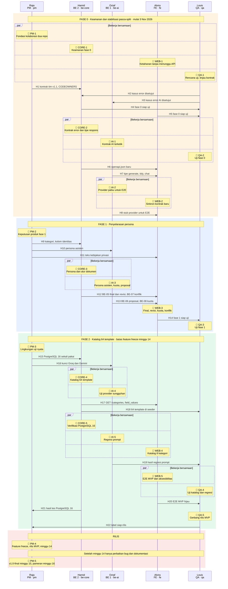
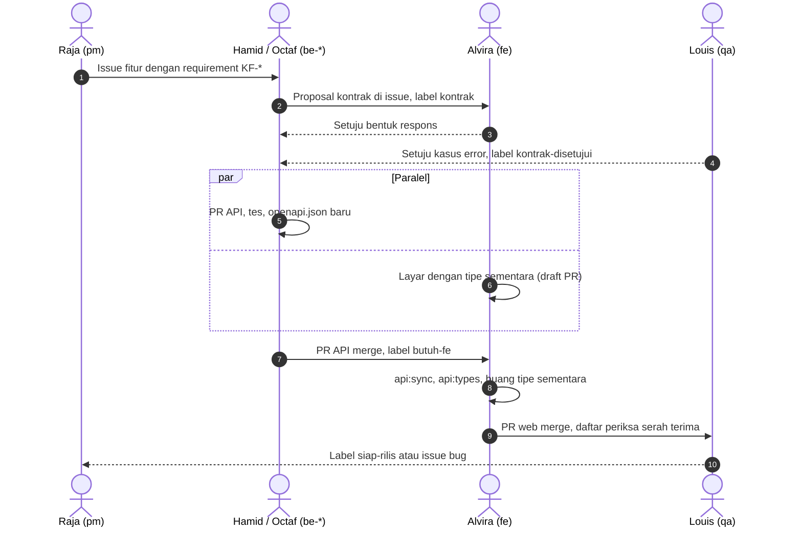
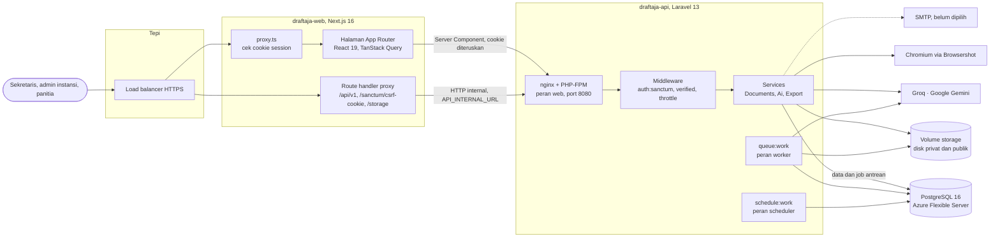
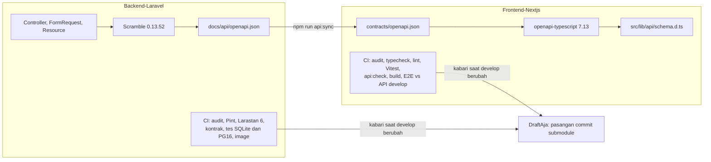

# DraftAja

### Dari catatan mentah ke dokumen kantor yang rapi.

Layanan web untuk sekretaris, admin instansi, dan panitia kegiatan. Pilih template atau unggah contoh dokumen instansi, tempel catatan rapat apa adanya, lalu DraftAja menyusunnya mengikuti struktur dan gaya bahasa contoh tersebut. Hasilnya diunduh sebagai DOCX atau PDF.

  
  
  
  
  
  

Proyek mata kuliah Proyek TI, Telkom University. Tim 5 orang, 16 minggu.

---

## Daftar isi

1. [Repositori](#repositori)
2. [Tim dan peran](#tim-dan-peran)
3. [Kolaborasi: milestone, alur paralel, dan serah terima](#kolaborasi-milestone-alur-paralel-dan-serah-terima)
4. [MVP](#mvp)
5. [Arsitektur sistem end-to-end](#arsitektur-sistem-end-to-end)
6. [Teknologi dan versi](#teknologi-dan-versi)
7. [Mulai di sini untuk anggota baru](#mulai-di-sini-untuk-anggota-baru)

> [!NOTE]
> Repo kode bersifat privat. Tautan bertanda 🔒 hanya bisa dibuka anggota organisasi yang sudah masuk ke GitHub. Ringkasan setiap milestone ditulis langsung di halaman ini agar bisa dibaca tanpa membuka berkas dokumentasi satu per satu.

## Repositori

| Repo | Isi | Pemilik utama | Branch kerja |
|---|---|---|---|
| 🔒 [Backend-Laravel](https://github.com/DraftAja/Backend-Laravel) (draftaja-api) | API JSON `/api/v1`, aturan bisnis, data, antrean, AI, ekspor. Juga sumber spesifikasi produk di `docs/`. | `be-core`, `be-ai` | `develop` |
| 🔒 [Frontend-Nextjs](https://github.com/DraftAja/Frontend-Nextjs) (draftaja-web) | Semua halaman termasuk landing, proxy same-origin ke API, E2E Playwright. | `fe` | `develop` |
| 🔒 [DraftAja](https://github.com/DraftAja/DraftAja) | Repo gabungan. Mencatat pasangan commit `develop` kedua repo sebagai submodule. | `pm` | `main` |
| [.github](https://github.com/DraftAja/.github) | Profil organisasi ini dan template issue bawaan untuk semua repo. | `pm` | `main` |

Monolit Laravel + Inertia dipecah menjadi dua repo pada **3 November 2026**. Sejak itu backend dan frontend bisa dikerjakan paralel, dengan `openapi.json` sebagai kontrak di antara keduanya.

## Tim dan peran

| Anggota | Peran | Alias branch | Area | Dokumen yang dipegang |
|---|---|---|---|---|
| **Ahmad Raja Fadhil** ([@rajafadhil](https://github.com/rajafadhil)) | Project Manager | `pm` | Kontrak tim, konfigurasi repo, CI/CD, rilis dan tag, keputusan produk | API `docs/01`, `06`, `11` sampai `14`, `17`, `TEAM_CONTRACT.md` |
| **Abdurrahman Abdul Hamid** ([@abdhaamed](https://github.com/abdhaamed)) | Backend 2, modul inti | `be-core` | Auth, dokumen (laporan), template, ekspor, keamanan data | API `docs/04`, `05`, `07`, `18` (butir `be-core`) |
| **M. Octafachdiansyah D.** ([@octafex](https://github.com/octafex)) | Backend 1, modul AI | `be-ai` | Pembelajaran pola, perapihan, generate dan chat, kuota AI | API `docs-ai/`, `docs/08`, `18` (butir `be-ai`) |
| **Alvira Risky** | Frontend | `fe` | Seluruh draftaja-web | web `docs/03` sampai `07` |
| **Louis Andreas** | QA | `qa` | Rencana uji, kasus negatif, E2E, laporan bug, tanda siap rilis | API `docs/16`, web `docs/07` |

Pembagian `be-core` dan `be-ai` mengikuti `TEAM_CONTRACT.md` bagian 2, 9, dan Lampiran A. Bagian 3 kontrak masih menulis kebalikannya; penyelarasannya adalah milestone **PM-1** di bawah.

---

## Kolaborasi: milestone, alur paralel, dan serah terima

Semua pekerjaan kolaborasi berawal dari milestone. Setiap anggota memegang lima milestone yang membatasi apa yang menjadi tanggung jawabnya, dan setiap milestone merujuk butir backlog yang sudah ditulis di dokumentasi kedua repo:

- Backlog backend `BE-01` sampai `BE-17` dan temuan `S-xx`: 🔒 [API doc 18](https://github.com/DraftAja/Backend-Laravel/blob/develop/docs/18-audit-pasca-split.md#backlog-backend)
- Backlog frontend `FE-01` sampai `FE-26`: 🔒 [web doc 06](https://github.com/DraftAja/Frontend-Nextjs/blob/develop/docs/06-backlog-frontend.md)
- Fase roadmap 0 sampai 5: 🔒 [API doc 10](https://github.com/DraftAja/Backend-Laravel/blob/develop/docs/10-project-status-and-gaps.md#roadmap)
- Kriteria rilis MVP: 🔒 [API doc 16](https://github.com/DraftAja/Backend-Laravel/blob/develop/docs/16-strategi-pengujian.md#kriteria-rilis-mvp)

### Jadwal besar

MVP adalah **fase 0 sampai 2** dan harus selesai sebelum feature freeze minggu 14. Fase 3 dan 4 dikerjakan bila kapasitas tersedia. Tanggal jatuh tempo setiap milestone diisi PM saat membuat GitHub Milestone di repo terkait.

| Fase | Tujuan | Milestone yang terlibat | Batas |
|---|---|---|---|
| 0 | Keamanan dan stabilisasi pasca-split | PM-1, CORE-1, CORE-2, AI-1, AI-2, WEB-1, WEB-2, QA-1, QA-2 | Sebelum fitur lain dibangun di atasnya |
| 1 | Penyelarasan persona: kategori, final dan revisi, kuota | PM-2, CORE-3, AI-3, WEB-3, QA-3 | Sebelum fase 2 |
| 2 | Katalog 64 template, kolom isian, regresi prompt | PM-3, CORE-4, CORE-5, AI-4, AI-5, WEB-4, WEB-5, QA-4, QA-5 | Feature freeze **minggu 14** |
| Rilis | MVP dibekukan, `v1.0-final`, pameran | PM-4, PM-5 | Minggu 14, 15, 16 |
| 3 dan 4 | Ruang kerja instansi, tinjau dan penomoran | Ditambahkan sebagai milestone baru bila kapasitas ada | Setelah MVP |

### Diagram alur paralel

Lima kotak di atas adalah lima anggota yang bekerja beriringan. Garis yang turun dari setiap kotak adalah alur kerja orang itu, dibaca dari atas ke bawah.

| Tanda | Arti |
|---|---|
| 🏁 di atas garis | Titik milestone: pekerjaan sampai titik ini selesai, lalu orang itu lanjut ke milestone berikutnya di garis yang sama |
| Bingkai `par` "Bekerja bersamaan" | Milestone di dalamnya dikerjakan pada waktu yang sama oleh orang yang berbeda |
| Panah mendatar `H1` sampai `H22` | Serah terima: pengirim melapor atau menyerahkan hasil, penerima memakainya untuk milestone berikutnya. Rinciannya di [tabel serah terima](#titik-serah-terima) |
| Blok berwarna | Fase roadmap. MVP adalah fase 0 sampai 2 |
| 🚩 | Gerbang rilis |

### Titik serah terima

Setiap baris adalah janji antar anggota. Pengirim belum dianggap selesai sebelum penerima bisa memakai hasilnya. Kanal yang dipakai mengikuti 🔒 [API doc 17, label issue](https://github.com/DraftAja/Backend-Laravel/blob/develop/docs/17-kolaborasi-dan-serah-terima.md#label-issue).

| No | Dari | Ke | Yang diserahkan | Kanal | Dipakai penerima untuk |
|---|---|---|---|---|---|
| H1 | Raja | Hamid, semua | `TEAM_CONTRACT.md` v1.1, CODEOWNERS per repo, branch protection | PR ke `develop`, pengumuman di grup | Reviewer wajib berlaku sebelum BE-03 mengubah kontrak error |
| H2 | Louis | Hamid | Persetujuan daftar `code` error di proposal kontrak | Komentar di issue `kontrak`, label `kontrak-disetujui` | Menulis tes per `code` di BE-03 |
| H3 | Louis | Octaf | Persetujuan kasus error endpoint AI | Issue `kontrak` | Mengunci bentuk respons AI di BE-04 |
| H4 | Hamid | Louis | PR fase 0 yang sudah merge beserta cara memicu setiap error | Daftar periksa serah terima QA di PR | Uji kasus negatif fase 0 |
| H5 | Alvira | Louis | Pasangan commit API dan web, tangkapan layar 360 px dan desktop | PR web | Uji tampilan status tak dikenal, mode baca, zona waktu |
| H6 | Hamid | Alvira | `openapi.json` dengan skema error dan tipe respons inti | PR API merge, label `butuh-fe` | `npm run api:sync && npm run api:types`, mengosongkan "Kontrak manual" |
| H7 | Octaf | Alvira | Tipe `Generation`, `CleanupReservation`, `ChatReply` di `openapi.json` | PR API merge, label `butuh-fe` | FE-08 tanpa tipe tulisan tangan |
| H8 | Octaf | Alvira, Louis | Cara mengarahkan `AI_*` ke provider palsu lokal | Issue kesepakatan, doc 09 | E2E perapihan tanpa kunci sungguhan (FE-23) di WEB-5 |
| H9 | Raja | Hamid | Keputusan 8 kunci kategori dan kolom identitas pengganti kolom akademik | Issue keputusan, doc 12 diperbarui | Enum `DocumentCategory`, migrasi kolom (KF-DOK-04) |
| H10 | Raja | Octaf | Persona dan batas asisten DraftAja | Issue keputusan, doc 01 dan 11 | Mengganti prompt "LaporBot" (KF-AI-05) |
| H11 | Raja | Alvira | Isi kebijakan privasi | Issue keputusan | Halaman `/kebijakan-privasi` (FE-15) |
| H12 | Hamid | Alvira | `POST /laporan/{id}/finalize`, `/revisions`, 409 `revision_changed` | PR API merge, label `butuh-fe` | FE-12 tombol final dan revisi, FE-14 dialog konflik |
| H13 | Octaf | Alvira | `GET /ai/quota`, field `proposal` berbentuk objek | PR API merge, label `butuh-fe` | FE-13 kartu kuota, FE-18 tanpa `JSON.parse` |
| H14 | Alvira | Louis | Fase 1 lengkap di kedua repo, PR web merujuk PR API | Repo gabungan mencatat pasangan commit | Uji transisi status, persona, ekspor per kategori |
| H15 | Raja | Hamid | Instance PostgreSQL 16 sekali pakai dan izin pemakaiannya | Kanal aman, bukan repo | Menjalankan tes konkurensi dan schema check |
| H16 | Raja | Octaf | Kunci Groq dan Gemini, izin eksplisit, nama `GEMINI_MODEL` aktif | Kanal aman, bukan chat grup terbuka | Smoke test dan regresi prompt |
| H17 | Hamid | Alvira | `GET /categories`, `template_fields`, `field_values` | PR API merge, label `butuh-fe` | FE-17 katalog dan kolom isian |
| H18 | Hamid | Louis | 64 template di `TemplateSeeder` sesuai `docs/templates/` | PR API merge | Uji kesesuaian spesifikasi dan seeder |
| H19 | Octaf | Louis | Keluaran 10 pasang catatan untuk Groq dan Gemini | Dicatat di doc 10 dan `docs-ai/07-testing.md` | Pemeriksaan fakta tambahan dan penanda `[perlu dilengkapi]` |
| H20 | Alvira | Louis | E2E P1 dan "P2 bagian template" lulus di 360 px dan 1440 px | CI web hijau | Kriteria rilis butir 5 |
| H21 | Hamid | Raja | Hasil rangkaian tes PostgreSQL 16 | Doc 10 bagian verifikasi | Kriteria rilis butir 1 |
| H22 | Louis | Raja | Label `siap-rilis` pada pasangan commit | Issue di repo gabungan | Membuat `release/*`, tag pasangan versi |

### Milestone per anggota

Klik nama anggota untuk membuka milestone-nya. Kolom **Rujukan** langsung menuju bagian dokumen yang relevan.

<b>Raja · PM</b> · PM-1 sampai PM-5

| Milestone | Isi pekerjaan | Selesai bila | Serah terima | Rujukan |
|---|---|---|---|---|
| **PM-1** Fondasi kolaborasi dua repo | BE-15: revisi `TEAM_CONTRACT.md` v1.1 (pemetaan nama ke `be-core`/`be-ai`, kepemilikan per repo, aturan PR lintas repo). CODEOWNERS di kedua repo. Branch protection `main` dan `develop`. Label dari kontrak dan doc 17. GitHub Milestone dan papan Projects. Mengundang Alvira dan Louis ke organisasi. | Disetujui 4 dari 5 anggota; review pemilik kode diwajibkan di kedua repo; label tersedia | Kirim H1 | 🔒 [Usulan revisi v1.1](https://github.com/DraftAja/Backend-Laravel/blob/develop/docs/17-kolaborasi-dan-serah-terima.md#usulan-revisi-team_contractmd-v11) · 🔒 [S-19](https://github.com/DraftAja/Backend-Laravel/blob/develop/docs/18-audit-pasca-split.md#proses-lintas-repo) · 🔒 [Lampiran B](https://github.com/DraftAja/Backend-Laravel/blob/develop/TEAM_CONTRACT.md#lampiran-b-pengaturan-branch-protection-github) |
| **PM-2** Keputusan produk fase 1 | Menetapkan 8 kunci kategori, kolom identitas dokumen pengganti `nim`/`prodi`/`dosen_pembimbing`, persona asisten, isi kebijakan privasi. Memperbarui doc 12 dengan kriteria terima yang bisa diuji. | Setiap keputusan tercatat sebagai issue tertutup dan doc 01, 11, 12 diperbarui | Kirim H9, H10, H11 | 🔒 [Keputusan A1 sampai A10](https://github.com/DraftAja/Backend-Laravel/blob/develop/docs/README.md#keputusan-yang-diambil-saat-menyusun-ulang-dokumen) · 🔒 [doc 12](https://github.com/DraftAja/Backend-Laravel/blob/develop/docs/12-kebutuhan-sistem.md) · 🔒 [Fase 1](https://github.com/DraftAja/Backend-Laravel/blob/develop/docs/10-project-status-and-gaps.md#fase-1-penyelarasan-persona) |
| **PM-3** Lingkungan uji nyata | Menyediakan PostgreSQL 16 sekali pakai dan staging, kunci Groq dan Gemini dengan izin pemakaian. Menyiapkan urutan deploy API lalu web. | Hamid dan Octaf menerima akses lewat kanal aman | Kirim H15, H16 | 🔒 [Langkah verifikasi](https://github.com/DraftAja/Backend-Laravel/blob/develop/docs/10-project-status-and-gaps.md#langkah-verifikasi-yang-harus-dijadwalkan) · 🔒 [Urutan merge dan deploy](https://github.com/DraftAja/Backend-Laravel/blob/develop/docs/17-kolaborasi-dan-serah-terima.md#urutan-merge-dan-deploy) |
| **PM-4** Feature freeze dan rilis MVP, minggu 14 | Memeriksa 7 kriteria rilis MVP, menerima tertulis risiko yang tersisa, membuat `release/*`, tag pasangan versi di kedua repo, mengisi tabel pasangan rilis. | Kriteria rilis terpenuhi atau risikonya diterima tertulis | Terima H21, H22 | 🔒 [Kriteria rilis MVP](https://github.com/DraftAja/Backend-Laravel/blob/develop/docs/16-strategi-pengujian.md#kriteria-rilis-mvp) · 🔒 [Kontrak tim bagian 11](https://github.com/DraftAja/Backend-Laravel/blob/develop/TEAM_CONTRACT.md#11-rilis-milestone-dan-code-freeze) |
| **PM-5** `v1.0-final` dan pameran | Minggu 15: merge `develop` ke `main`, tag `v1.0-final`, penyerahan dokumen mata kuliah. Minggu 16: hanya `hotfix/*`. | Tag ada di kedua repo dan repo gabungan | Ke semua anggota | 🔒 [Kontrak tim bagian 11](https://github.com/DraftAja/Backend-Laravel/blob/develop/TEAM_CONTRACT.md#11-rilis-milestone-dan-code-freeze) |

<b>Hamid · BE 2 · be-core</b> · CORE-1 sampai CORE-5

| Milestone | Isi pekerjaan | Selesai bila | Serah terima | Rujukan |
|---|---|---|---|---|
| **CORE-1** Keamanan fase 0 | BE-01 policy ekspor dokumen final. BE-02 validasi `templates.use`. BE-09 gambar editor dan logo di disk privat. BE-17 HTMLPurifier untuk isi bagian dan CSP pratinjau. `UserSeeder` hanya lokal dan tes. | Tes fase 0 di doc 16 ada dan lulus; S-01, S-02, S-13, S-21 ditutup | Kirim H4 | 🔒 [Backlog backend](https://github.com/DraftAja/Backend-Laravel/blob/develop/docs/18-audit-pasca-split.md#backlog-backend) · 🔒 [Fase 0](https://github.com/DraftAja/Backend-Laravel/blob/develop/docs/10-project-status-and-gaps.md#fase-0-keamanan-dan-stabilisasi-pasca-split) · 🔒 [Risiko doc 07](https://github.com/DraftAja/Backend-Laravel/blob/develop/docs/07-authentication-security.md#risiko) |
| **CORE-2** Kontrak error dan tipe respons | BE-03 renderer error tunggal dengan `code` dan pesan Indonesia, skema `ErrorResponse`. BE-04 bagian inti: respons dashboard, options, dan template. BE-11 `securitySchemes`. | Tes katalog: setiap error `api/*` punya `message` dan `code`; `openapi.json` memuat skema | Terima H1, H2. Kirim H6 | 🔒 [Proposal kontrak](https://github.com/DraftAja/Backend-Laravel/blob/develop/docs/17-kolaborasi-dan-serah-terima.md#proposal-kontrak) · 🔒 [Tes kontrak](https://github.com/DraftAja/Backend-Laravel/blob/develop/docs/16-strategi-pengujian.md#tes-kontrak) · 🔒 [doc 05](https://github.com/DraftAja/Backend-Laravel/blob/develop/docs/05-api-documentation.md) |
| **CORE-3** Persona dan alur dokumen | Enum `DocumentCategory` dan migrasi nilai lama. Kolom identitas pengganti kolom akademik. Menghapus jenis akademik (S-22). BE-05 final dan revisi. BE-07 konkurensi bagian. BE-10 `MustVerifyEmail`. Tata letak ekspor per kategori. | DOCX Surat tanpa sampul dan daftar isi; dokumen final menolak suntingan 403 | Terima H9. Kirim H12 | 🔒 [Fase 1](https://github.com/DraftAja/Backend-Laravel/blob/develop/docs/10-project-status-and-gaps.md#fase-1-penyelarasan-persona) · 🔒 [Tes per fase](https://github.com/DraftAja/Backend-Laravel/blob/develop/docs/16-strategi-pengujian.md#tes-yang-wajib-ditambah-per-fase) · 🔒 [doc 04](https://github.com/DraftAja/Backend-Laravel/blob/develop/docs/04-database-design.md) |
| **CORE-4** Katalog 64 template | 64 template di `TemplateSeeder` dari spesifikasi. Tabel `template_fields` dan `laporans.field_values`. `GET /categories`. BE-12 `url` deprecated. BE-13 paginasi `GET /laporan`. | `TemplateSeedTest` mengharapkan 64, tepat 8 per kategori; tes kesesuaian spesifikasi dan seeder lulus | Kirim H17, H18 | 🔒 [Katalog template](https://github.com/DraftAja/Backend-Laravel/blob/develop/docs/templates/README.md) · 🔒 [Fase 2](https://github.com/DraftAja/Backend-Laravel/blob/develop/docs/10-project-status-and-gaps.md#fase-2-katalog-64-template) |
| **CORE-5** Verifikasi PostgreSQL 16 | Seluruh rangkaian tes, migrasi, upgrade, `documents:schema-check`, dan uji pemulihan di PostgreSQL 16 sekali pakai. BE-14 dan BE-16 bila kapasitas ada. | Hasil tercatat di doc 10 bagian verifikasi | Terima H15. Kirim H21 | 🔒 [Verifikasi](https://github.com/DraftAja/Backend-Laravel/blob/develop/docs/10-project-status-and-gaps.md#verifikasi) · 🔒 [Roadmap AI](https://github.com/DraftAja/Backend-Laravel/blob/develop/docs-ai/08-roadmap.md) · 🔒 [Setup](https://github.com/DraftAja/Backend-Laravel/blob/develop/docs/09-setup-development.md) |

<b>Octaf · BE 1 · be-ai</b> · AI-1 sampai AI-5

| Milestone | Isi pekerjaan | Selesai bila | Serah terima | Rujukan |
|---|---|---|---|---|
| **AI-1** Kontrak AI terketik | BE-04 bagian AI: `Generation`, `CleanupReservation`, `ChatReply` muncul di `openapi.json` tanpa mengubah bentuk JSON. S-16: menyelaraskan `docs-ai/05-api.md` dengan doc 05. | Bagian AI di "Kontrak manual" web bisa dihapus dan `tsc` tetap lolos | Terima H3. Kirim H7 | 🔒 [Backlog backend](https://github.com/DraftAja/Backend-Laravel/blob/develop/docs/18-audit-pasca-split.md#backlog-backend) · 🔒 [docs-ai](https://github.com/DraftAja/Backend-Laravel/blob/develop/docs-ai/README.md) |
| **AI-2** Provider palsu untuk E2E | Menyepakati dan menyediakan cara mengarahkan `AI_*` ke stub lokal untuk CI web. | Tes E2E bisa menjalankan perapihan tanpa kunci sungguhan | Kirim H8 | 🔒 [FE-23](https://github.com/DraftAja/Frontend-Nextjs/blob/develop/docs/06-backlog-frontend.md#pengujian) · 🔒 [Aturan E2E](https://github.com/DraftAja/Frontend-Nextjs/blob/develop/docs/07-pengujian.md#aturan-menulis-tes-e2e) |
| **AI-3** Persona asisten, kuota, proposal | Prompt chat berpersona asisten DraftAja tanpa "LaporBot" (KF-AI-05). BE-08 `GET /ai/quota`. BE-06 field `proposal` berbentuk objek. | Prompt sistem tidak memuat "LaporBot" atau "Lapor.in"; `used` bertambah sesuai potongan | Terima H10. Kirim H13 | 🔒 [Fase 1](https://github.com/DraftAja/Backend-Laravel/blob/develop/docs/10-project-status-and-gaps.md#fase-1-penyelarasan-persona) · 🔒 [Rencana penggantian field](https://github.com/DraftAja/Backend-Laravel/blob/develop/docs/18-audit-pasca-split.md#rencana-penggantian-field) |
| **AI-4** Uji provider sungguhan | Smoke test Groq dan Gemini untuk analisis pola dan perapihan. Mencatat token rata-rata per dokumen untuk perhitungan biaya. | Hasil tanpa rahasia tercatat di doc 10 dan `docs-ai/07-testing.md` | Terima H16 | 🔒 [Roadmap AI](https://github.com/DraftAja/Backend-Laravel/blob/develop/docs-ai/08-roadmap.md) · 🔒 [Integrasi](https://github.com/DraftAja/Backend-Laravel/blob/develop/docs/08-integrations.md) · 🔒 [Struktur biaya](https://github.com/DraftAja/Backend-Laravel/blob/develop/docs/14-model-bisnis.md#struktur-biaya) |
| **AI-5** Regresi prompt | Minimal 10 pasang catatan dari bagian "Contoh" spesifikasi template, sebaran kategori merata, untuk Groq dan Gemini. | Nol fakta tambahan; catatan yang kurang menghasilkan `[perlu dilengkapi]` | Kirim H19 | 🔒 [Regresi prompt AI](https://github.com/DraftAja/Backend-Laravel/blob/develop/docs/16-strategi-pengujian.md#regresi-prompt-ai) |

<b>Alvira · FE</b> · WEB-1 sampai WEB-5

| Milestone | Isi pekerjaan | Selesai bila | Serah terima | Rujukan |
|---|---|---|---|---|
| **WEB-1** Ketahanan tanpa menunggu API | FE-01 status tak dikenal. FE-02 mode baca untuk selain `draft`. FE-04 sembunyikan jenis dokumen akademik. FE-05 batas waktu polling. FE-06 zona waktu `Asia/Jakarta`. FE-07 kontras border 3:1. FE-09 peringatan drift kontrak. FE-16 pesan 400. | Tes Vitest untuk FE-01, FE-06, FE-16 lulus | Kirim H5 | 🔒 [Ketahanan](https://github.com/DraftAja/Frontend-Nextjs/blob/develop/docs/06-backlog-frontend.md#ketahanan-terhadap-perubahan-api) · 🔒 [Kebenaran tampilan](https://github.com/DraftAja/Frontend-Nextjs/blob/develop/docs/06-backlog-frontend.md#kebenaran-tampilan) |
| **WEB-2** Sinkron kontrak baru | FE-03 cabang `code === 'email_unverified'`. FE-08 tipe dari `schema.d.ts`. | Bagian "Kontrak manual" kosong atau hanya tipe sementara bernomor issue | Terima H6, H7 | 🔒 [Bekerja sebelum API siap](https://github.com/DraftAja/Backend-Laravel/blob/develop/docs/17-kolaborasi-dan-serah-terima.md#bekerja-sebelum-api-siap) · 🔒 [Integrasi API](https://github.com/DraftAja/Frontend-Nextjs/blob/develop/docs/04-integrasi-api.md) |
| **WEB-3** Final, revisi, kuota, konflik | FE-11 penanda `[perlu dilengkapi]`. FE-12 tombol final dan revisi. FE-15 `not-found`, `error`, `/kebijakan-privasi`. FE-13 kartu kuota. FE-14 dialog konflik. FE-18 `proposal` objek. Dialog data dokumen dengan kolom identitas baru. | Semua keadaan di peta halaman ditangani; diuji di 360 px dan desktop | Terima H11, H12, H13. Kirim H14 | 🔒 [Alur yang menunggu API](https://github.com/DraftAja/Frontend-Nextjs/blob/develop/docs/06-backlog-frontend.md#alur-yang-menunggu-api) · 🔒 [Peta halaman](https://github.com/DraftAja/Frontend-Nextjs/blob/develop/docs/03-peta-halaman.md) |
| **WEB-4** Katalog 8 kategori dan kolom isian | FE-17 katalog, pencarian, pratinjau struktur, kolom isian. Penanda kolom wajib kosong sebelum ekspor (KF-DOK-05). FE-21 ringkasan beranda. | Katalog memakai `GET /categories`; tidak ada istilah akademik yang tampil | Terima H17 | 🔒 [Fase 2](https://github.com/DraftAja/Backend-Laravel/blob/develop/docs/10-project-status-and-gaps.md#fase-2-katalog-64-template) · 🔒 [Sistem desain](https://github.com/DraftAja/Frontend-Nextjs/blob/develop/docs/05-sistem-desain.md) |
| **WEB-5** E2E MVP dan aksesibilitas | FE-22 unggah template sampai `ready`. FE-23 perapihan sampai terima usulan. FE-24 unduh PDF. FE-26 pemeriksaan aksesibilitas 5 halaman utama (dependensi baru butuh persetujuan). | E2E lulus di profil desktop dan ponsel | Terima H8. Kirim H20 | 🔒 [Pengujian frontend](https://github.com/DraftAja/Frontend-Nextjs/blob/develop/docs/07-pengujian.md#yang-wajib-ditambah) · 🔒 [Uji peramban](https://github.com/DraftAja/Backend-Laravel/blob/develop/docs/16-strategi-pengujian.md#uji-peramban) |

<b>Louis · QA</b> · QA-1 sampai QA-5

| Milestone | Isi pekerjaan | Selesai bila | Serah terima | Rujukan |
|---|---|---|---|---|
| **QA-1** Rencana uji dan tinjauan kontrak | Menyusun rencana uji dari doc 16. Meninjau kasus error di setiap proposal kontrak sebelum label `kontrak-disetujui`. Template laporan bug. | Rencana uji per fase tersedia; proposal kontrak yang terbuka sudah ditinjau | Kirim H2, H3 | 🔒 [Strategi pengujian](https://github.com/DraftAja/Backend-Laravel/blob/develop/docs/16-strategi-pengujian.md) · 🔒 [Proposal kontrak](https://github.com/DraftAja/Backend-Laravel/blob/develop/docs/17-kolaborasi-dan-serah-terima.md#proposal-kontrak) |
| **QA-2** Uji fase 0 | Kasus negatif untuk BE-01, BE-02, BE-09, BE-17. Memicu keadaan error manual (kuota habis, 401, 419, origin tidak stateful, DOCX ditolak). | Temuan P0 ditutup atau tercatat sebagai issue `bug` | Terima H4, H5 | 🔒 [Cara memicu error](https://github.com/DraftAja/Frontend-Nextjs/blob/develop/docs/07-pengujian.md#serah-terima-ke-qa) · 🔒 [Serah terima ke QA](https://github.com/DraftAja/Backend-Laravel/blob/develop/docs/17-kolaborasi-dan-serah-terima.md#serah-terima-ke-qa) |
| **QA-3** Uji fase 1 | Transisi final dan revisi, persona (pencarian istilah "Hindari"), ekspor per kategori, E2E kasus negatif. | Tidak ada bug prioritas tinggi terbuka untuk fase 1 | Terima H14 | 🔒 [Tes per fase](https://github.com/DraftAja/Backend-Laravel/blob/develop/docs/16-strategi-pengujian.md#tes-yang-wajib-ditambah-per-fase) · 🔒 [Sistem desain, kolom Hindari](https://github.com/DraftAja/Frontend-Nextjs/blob/develop/docs/05-sistem-desain.md) |
| **QA-4** Uji katalog dan regresi prompt | Memeriksa 64 template terhadap spesifikasi. Memeriksa keluaran regresi prompt secara manual. Menyiapkan sesi uji pengguna setelah fase 2. | Nol fakta tambahan disetujui; katalog sesuai spesifikasi | Terima H18, H19 | 🔒 [Regresi prompt AI](https://github.com/DraftAja/Backend-Laravel/blob/develop/docs/16-strategi-pengujian.md#regresi-prompt-ai) · 🔒 [Uji pengguna](https://github.com/DraftAja/Backend-Laravel/blob/develop/docs/16-strategi-pengujian.md#uji-pengguna) |
| **QA-5** Gerbang rilis MVP | Memeriksa 7 kriteria rilis MVP. Skenario peramban di Chromium, Firefox, WebKit pada 360 px dan 1440 px. Memasang `siap-rilis`. | Pasangan commit berlabel `siap-rilis` | Terima H20. Kirim H22 | 🔒 [Kriteria rilis MVP](https://github.com/DraftAja/Backend-Laravel/blob/develop/docs/16-strategi-pengujian.md#kriteria-rilis-mvp) |

### Siklus satu fitur lintas repo

Milestone di atas dikerjakan lewat siklus yang sama untuk setiap fitur yang menyentuh API dan antarmuka. Siklus lengkap ada di 🔒 [API doc 17](https://github.com/DraftAja/Backend-Laravel/blob/develop/docs/17-kolaborasi-dan-serah-terima.md#siklus-satu-fitur-lintas-repo).

### Aturan main harian

Diringkas dari 🔒 [`TEAM_CONTRACT.md`](https://github.com/DraftAja/Backend-Laravel/blob/develop/TEAM_CONTRACT.md) dan 🔒 [doc 17](https://github.com/DraftAja/Backend-Laravel/blob/develop/docs/17-kolaborasi-dan-serah-terima.md).

| Hal | Aturan |
|---|---|
| Mulai kerja | Setiap pekerjaan berawal dari issue yang terhubung ke satu milestone. Issue dipecah supaya selesai dalam 1 sampai 3 hari kerja. |
| Branch | `<tipe>/<alias>-<deskripsi>`, contoh `feat/be-core-export-docx`, `fix/fe-editor-tabel-hilang`. Dibuat dari `develop`, umur ideal 2 sampai 3 hari. |
| Commit | Conventional Commits dengan scope `auth`, `template`, `laporan`, `editor`, `ai`, `export`, `db`, `ui`, `api`, `test`, `docs`, `ci`, `deps`, `config`. |
| Push | Minimal sekali sehari. Dilarang push langsung ke `main` dan `develop`, dilarang `--force` di branch bersama. |
| Review | Minimal 1 approval, 2 untuk berkas bersama. Reviewer merespons paling lambat 1×24 jam hari kerja. |
| Urutan merge | PR API dengan `openapi.json` baru merge lebih dulu, baru PR web yang bergantung padanya. |
| Terblokir | Pasang label `blocked` atau `butuh-api` dan sampaikan di grup pada hari yang sama. |
| Rahasia | `.env`, kunci Groq/Gemini, dan dokumen asli instansi tidak pernah masuk repo. Bila bocor, cabut kunci dan kabari PM lebih dulu. |

**Definition of Ready** untuk tiket FE yang butuh API: proposal berlabel `kontrak-disetujui`, layar ada di peta halaman lengkap dengan keadaan kosong, memuat, dan error, setiap `code` error punya teks tampilan, dan requirement punya kriteria terima.

**Definition of Done**: CI hijau, tes untuk logika baru, `openapi.json` ikut di-commit bila menyentuh endpoint, tipe web dari `schema.d.ts`, diuji di 360 px dan desktop, PR saling merujuk, dan QA tidak menemukan bug prioritas tinggi.

### Label

| Label | Dipasang oleh | Arti |
|---|---|---|
| `be-core`, `be-ai`, `fe`, `qa`, `pm`, `docs` | pembuat issue | Area pemilik pekerjaan |
| `feature`, `bug`, `priority-high` | pembuat issue | Jenis dan prioritas |
| `blocked` | yang terblokir | Butuh keputusan, endpoint, atau desain dari anggota lain |
| `kontrak` | siapa saja | Issue berisi atau membutuhkan proposal kontrak |
| `kontrak-disetujui` | `fe` setelah `qa` setuju | Proposal final, implementasi boleh mulai |
| `memecah-kontrak` | `be-*` | Butuh `/api/v2` atau tahap deprecated |
| `butuh-api` | `fe` | Tiket FE terblokir endpoint yang belum ada |
| `butuh-fe` | `be-*` | Endpoint sudah merge, layar belum ada |
| `siap-rilis` | `qa` | Pasangan commit lolos uji |

Template issue **Proposal kontrak**, **Laporan bug**, dan **Tugas milestone** tersedia otomatis di semua repo organisasi lewat repo ini.

---

## MVP

MVP DraftAja adalah **fase 0 sampai 2** roadmap. Ukurannya sederhana: seorang sekretaris bisa membuat notula atau surat dari catatan rapatnya sendiri, tanpa bantuan, sampai mengunduh berkas yang siap dicetak. Semua yang dibutuhkan untuk perjalanan itu masuk MVP. Hal yang hanya berguna bagi instansi dengan banyak anggota ditunda ke fase berikutnya.

### Yang bisa dilakukan pengguna di MVP

| Kemampuan | Status per 3 Nov 2026 | Milestone |
|---|---|---|
| Daftar, masuk, keluar, reset kata sandi | Sudah ada | |
| Verifikasi email wajib | Sebagian | CORE-3 |
| Memilih template dari 64 template bawaan, 8 per kategori | Sebagian (baru 3 template) | CORE-4, WEB-4 |
| Mengunggah DOCX instansi dan menyimpan polanya secara berversi | Sudah ada | |
| Menempel catatan mentah per bagian, AI merapikan, pengguna menerima atau menolak per bagian | Sudah ada | |
| Penanda `[perlu dilengkapi]` untuk informasi yang tidak ada di catatan | Sebagian (belum disorot di editor) | WEB-3 |
| Melihat sisa kuota AI | Rencana | AI-3, WEB-3 |
| Menandai dokumen final dan membuat revisi | Sebagian (belum ada endpoint) | CORE-3, WEB-3 |
| Mengekspor DOCX dan PDF dengan tata letak sesuai kategori | Sebagian (selalu memakai sampul) | CORE-3 |
| Dokumen aman: gambar privat, HTML dibersihkan, error berbahasa Indonesia | Sebagian | CORE-1, CORE-2 |

### Aturan dasar AI

AI hanya merapikan fakta yang ditulis pengguna. Nama, angka, tanggal, nominal, dan nomor dokumen tidak boleh dibuat oleh AI. Bila catatan tidak menyebut sesuatu yang dibutuhkan template, AI menulis `[perlu dilengkapi]`. Aturan ini diuji lewat regresi prompt dengan ambang nol fakta tambahan (AI-5, QA-4).

### Di luar MVP

| Fase | Isi |
|---|---|
| 3 | Ruang kerja instansi: anggota, empat peran, undangan, kop surat, template resmi |
| 4 | Tinjau dan setujui, catatan per bagian, penomoran surat otomatis |
| 5, setelah masa proyek | Paket berbayar, Azure Blob Storage, login Google, dokumen turunan, unduhan seluruh data |

Sengaja tidak dikerjakan: penulisan akademik, tanda tangan elektronik tersertifikasi, arsip surat masuk, penyuntingan bersama real-time, dan AI yang menulis dari nol tanpa catatan.

### Kriteria rilis MVP

1. Semua tes lulus di SQLite, dan rangkaian tes sudah dijalankan sekali di PostgreSQL 16 dengan hasil tercatat.
2. Risiko R1 sampai R9 dan temuan P0 selesai atau diterima tertulis oleh PM.
3. Tidak ada istilah dari kolom "Hindari" di teks antarmuka.
4. Regresi prompt lulus dengan nol fakta tambahan untuk Groq dan Gemini.
5. Skenario peramban P1 dan "P2 bagian template" lulus di 360 px dan 1440 px.
6. Label status di dokumentasi sesuai kode.
7. `.env.example` memuat semua variabel baru tanpa nilai.

---

## Arsitektur sistem end-to-end

### Runtime

### Kontrak dan pengiriman

### Penjelasan

Pengguna DraftAja hanya pernah berbicara dengan satu origin, yaitu draftaja-web. Permintaan pertama melewati `proxy.ts`, yang cukup memeriksa ada tidaknya cookie session sebelum halaman area kerja dirender. Pemeriksaan ini cepat dan tidak memanggil API. Halaman kemudian dirender oleh App Router. Untuk halaman yang perlu tahu siapa penggunanya, Server Component memanggil `GET /api/v1/me` langsung ke alamat internal API sambil meneruskan cookie pengguna dan header `Origin` milik web. Laravel mengenali origin itu sebagai stateful, jadi session dan perlindungan CSRF Sanctum berlaku seperti pada aplikasi satu domain.

Setelah halaman tampil, setiap aksi pengguna di browser dikirim ke path relatif seperti `/api/v1/sections/12`. Route handler di Next.js meneruskannya ke API dengan daftar header yang dibatasi, mengalirkan unggahan tanpa menampungnya di memori, dan menulis ulang `Set-Cookie` serta `Location` agar tetap milik origin web. Hasil dari pola ini: cookie session tetap first-party dan HttpOnly, tidak ada CORS di produksi, dan tidak ada token yang disimpan di `localStorage`. Browser bahkan tidak tahu alamat API, karena memang tidak ada variabel `NEXT_PUBLIC_API_URL`.

Di sisi API, permintaan melewati middleware autentikasi, verifikasi email, dan pembatas laju sebelum sampai ke controller. Controller hanya memvalidasi lewat FormRequest, memeriksa hak lewat Policy, lalu menyerahkan kerja ke service. Service dokumen menangani unggahan DOCX, snapshot, dan perapihan. Service AI memegang klien Groq dan Gemini, reservasi kuota, dan validasi keluaran. Service ekspor membuat DOCX dengan PhpWord dan PDF dengan Browsershot yang menjalankan Chromium. Bentuk setiap respons ditentukan oleh Resource, sehingga Scramble bisa membaca dan menuliskannya ke `openapi.json`.

Pekerjaan yang lambat tidak dijalankan di dalam permintaan. Saat pengguna meminta analisis pola atau perapihan, controller mencatat reservasi di tabel `ai_generations`, menaruh job di antrean basis data dalam transaksi yang sama, lalu langsung membalas 202. Container worker mengambil job itu, memanggil provider AI, dan menyimpan hasilnya sebagai usulan. Frontend menanyakan status secara berkala dan menampilkan usulan begitu siap. Isi dokumen tidak pernah berubah sampai pengguna menekan terima, dan saat itu API memeriksa apakah dokumen sudah berubah sejak usulan dibuat. Container scheduler menjalankan pemulihan pekerjaan macet setiap 5 menit dan pembersihan riwayat AI setiap hari.

Semua data tinggal di PostgreSQL 16 pada Azure Database for PostgreSQL Flexible Server dengan TLS wajib. Kolom `jsonb` untuk pola dan penguncian baris untuk penomoran memang bergantung pada PostgreSQL, sementara pengembangan lokal dan tes harian memakai SQLite. Berkas unggahan disimpan di volume yang dibagi container web dan worker, karena worker perlu membaca DOCX yang diunggah lewat peran web. Volume ini akan diganti Azure Blob Storage setelah masa proyek.

Satu image Docker API dipakai untuk tiga peran: web, worker, dan scheduler. Sebelum melayani apa pun, entrypoint menjalankan `app:runtime-check` dan `env:verify`, yang menolak PHP versi rentan dan konfigurasi yang tidak sesuai kontrak environment. Endpoint `/up` menjalankan pemeriksaan yang sama. Container API tidak perlu terbuka ke internet, karena hanya container web yang memanggilnya lewat jaringan internal.

Kedua repo terikat oleh satu kontrak. Setiap kali endpoint berubah, `composer api:spec` menulis ulang `openapi.json`, dan CI API gagal bila berkas itu berbeda dari kode. Frontend menyalin kontrak itu, membangkitkan tipe TypeScript, dan CI web gagal bila tipe tidak sesuai. Job E2E web menjalankan Playwright terhadap API `develop` sungguhan. Setiap kali `develop` di salah satu repo berubah, repo gabungan DraftAja mencatat pasangan commit yang baru, dan pasangan itulah yang diuji QA lalu dirilis. Saat deploy, API dinaikkan lebih dulu karena API baru wajib tetap melayani web lama, lalu web menyusul. Bila web bermasalah, cukup web yang dikembalikan.

---

## Teknologi dan versi

Versi diambil dari `composer.lock`, `package-lock.json`, `Dockerfile`, dan workflow CI di branch `develop` per 4 November 2026.

### Frontend: draftaja-web

| Teknologi | Versi | Fungsi |
|---|---|---|
| Node.js | 24 (`>=24 <25`) | Runtime build dan server standalone |
| Next.js | 16.4.4 | App Router, route handler proxy, server standalone |
| React dan React DOM | 19.3.1 | Antarmuka |
| TypeScript | 5.9.3 | Tipe, termasuk tipe kontrak dari `openapi.json` |
| Tailwind CSS | 4.3.4 | Gaya, lewat `@tailwindcss/postcss` 4.3.4 |
| TanStack Query | 5.105.3 | Pengambilan data, cache, polling |
| TipTap | 3.32.2 | Editor isi bagian (`starter-kit`, `image`, `text-align`, `text-style`) |
| dnd-kit | core 6.3.1, sortable 10.0.0 | Urut ulang bab dan sub-bab |
| React Hook Form | 7.91.0 | Formulir, dengan `@hookform/resolvers` 7.0.1 |
| Zod | 4.6.7 | Validasi formulir dan env |
| `@t3-oss/env-nextjs` | 0.13.11 | Validasi variabel env saat start |
| Headless UI | 2.2.10 | Komponen dialog dan menu yang aksesibel |
| React Markdown | 10.1.0, dengan `remark-gfm` 4.0.1 | Menampilkan jawaban asisten |
| Three.js | 0.160.1 (dipin) | Landing page |
| Motion | 12.23.24 (dipin) | Animasi landing page |

### Backend: draftaja-api

| Teknologi | Versi | Fungsi |
|---|---|---|
| PHP | minimal 8.4.27 atau 8.5.12; image `php:8.4.27-fpm-bookworm` | Runtime. Versi di bawahnya ditolak `app:runtime-check` |
| Laravel | 13.39.0 | Framework API |
| Laravel Sanctum | 4.3.3 | Session SPA lewat proxy same-origin |
| Scramble (`dedoc/scramble`) | 0.13.52 (dipin) | Membangkitkan `openapi.json` |
| PhpWord | 1.4.0 | Ekspor DOCX. Pembacaan DOCX unggahan memakai `DocxDocumentReader` milik sendiri |
| Browsershot | 5.4.2 | Ekspor PDF |
| Puppeteer | 25.16.0 (dipin) | Chrome untuk Browsershot di lokal dan CI |
| HTMLPurifier | 4.19.1 | Membersihkan HTML hasil perapihan AI. Isi bagian menyusul lewat BE-17 |
| Guzzle | 8.3.1 | Klien HTTP ke Groq dan Gemini |
| Laravel Tinker | 3.0.2 | Konsol |
| nginx | paket Debian bookworm | Server web di image |
| Chromium | paket Debian bookworm | Render PDF di image |

### Data, AI, dan infrastruktur

| Teknologi | Versi | Fungsi |
|---|---|---|
| PostgreSQL | 16 (Azure Database for PostgreSQL Flexible Server; `postgres:16-alpine` di CI dan Docker Compose) | Basis data staging dan produksi |
| SQLite | bawaan PHP | Basis data lokal dan tes |
| Groq | API kompatibel OpenAI `v1`, model bawaan `openai/gpt-oss-120b` | Provider bawaan chat (`AI_CHAT_PROVIDER`) |
| Google Gemini | API `v1beta`, model wajib diisi lewat `GEMINI_MODEL` | Provider bawaan untuk analisis pola, perapihan, dan generate (`AI_GENERATE_PROVIDER`) |
| Docker | image `node:24-bookworm-slim`, `composer:2` | Satu image API untuk peran web, worker, scheduler; image standalone untuk web |
| GitHub Actions | `actions/checkout` v4 (API) dan v7 (web), `shivammathur/setup-php` v2, `docker/build-push-action` v6 (API) dan v7 (web) | CI kedua repo |
| Dependabot | | Pembaruan dependensi Composer, npm, GitHub Actions, dan image Docker |

### Kualitas dan pengujian

| Alat | Versi | Repo |
|---|---|---|
| PHPUnit | 13.4.5 | API |
| Larastan / PHPStan | 3.13.2 / 2.3.4, level 6 | API |
| Laravel Pint | 1.32.1 | API |
| Mockery, Faker, Collision, Pail, Sail | 1.6.15, 1.24.1, 8.9.5, 1.2.7, 1.69.0 | API |
| `roave/security-advisories` | `dev-latest` | API, memblok paket rentan |
| Vitest | 5.1.0 | Web |
| Playwright | 1.64.1 | Web, profil Desktop Chrome dan Pixel 7 |
| ESLint | 10.14.0, dengan `eslint-config-next` 16.4.4 | Web |
| Prettier | 3.9.10, dengan `prettier-plugin-tailwindcss` 0.8.1 | Web |
| openapi-typescript | 7.13.0 | Web |

### Yang akan dipakai

Versi belum ditetapkan untuk teknologi yang belum masuk kode. Versinya dipilih dan dicatat pada PR yang menambahkannya, sesuai aturan dependensi baru di kontrak tim.

| Teknologi | Rencana pemakaian | Kapan |
|---|---|---|
| `@axe-core/playwright` | Pemeriksaan aksesibilitas otomatis di 5 halaman utama (FE-26) | Fase 2, butuh persetujuan dependensi |
| Layanan SMTP | Verifikasi email, undangan ruang kerja, notifikasi tinjauan. Penyedia belum dipilih. | Fase 3 |
| Azure Blob Storage | Pengganti volume bersama untuk berkas unggahan | Fase 5 |
| Laravel Socialite, Google OAuth | Masuk dengan akun Google. Masih usulan, menunggu keputusan PM. | Fase 5 |
| Gerbang pembayaran | Paket berbayar per ruang kerja. Penyedia belum dipilih. | Fase 5 |

---

## Mulai di sini untuk anggota baru

1. Baca 🔒 [`TEAM_CONTRACT.md`](https://github.com/DraftAja/Backend-Laravel/blob/develop/TEAM_CONTRACT.md) dan bagian [Kolaborasi](#kolaborasi-milestone-alur-paralel-dan-serah-terima) di halaman ini.
2. Pahami produk: 🔒 [doc 01 Ringkasan produk](https://github.com/DraftAja/Backend-Laravel/blob/develop/docs/01-project-overview.md), lalu 🔒 [doc 11 Persona](https://github.com/DraftAja/Backend-Laravel/blob/develop/docs/11-persona-dan-perjalanan-pengguna.md).
3. Ikuti urutan baca sesuai peran: 🔒 [indeks dokumentasi API](https://github.com/DraftAja/Backend-Laravel/blob/develop/docs/README.md#urutan-baca) atau 🔒 [indeks dokumentasi web](https://github.com/DraftAja/Frontend-Nextjs/blob/develop/docs/README.md#urutan-baca).
4. Jalankan kedua aplikasi di lokal: 🔒 [setup API](https://github.com/DraftAja/Backend-Laravel/blob/develop/docs/09-setup-development.md) dan 🔒 [README web](https://github.com/DraftAja/Frontend-Nextjs/blob/develop/README.md). Pastikan `session.upload_progress.enabled = Off` di `php.ini`.
5. Ambil issue dari milestone milikmu, buat branch dari `develop`, dan buka PR dengan template yang tersedia.

DraftAja · Proyek TI, Telkom University · 2026

