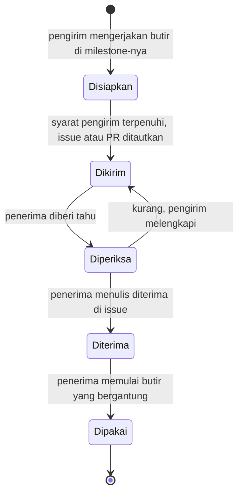

[Profil organisasi](https://github.com/DraftAja) · [Semua milestone](../milestone/README.md)

# Serah terima

Serah terima adalah titik ketika hasil kerja satu anggota menjadi bahan kerja anggota lain. Di diagram profil, setiap serah terima digambar sebagai panah mendatar dengan label `H<nomor> · <milestone pengirim> → <milestone penerima> · <isi>`. Setiap label punya halaman sendiri di folder ini, berisi isi paket, syarat sebelum dikirim, cara mengirim, cara penerima memeriksa, dan apa yang dilakukan bila terlambat.

## Aturan umum

1. **Pengirim belum selesai sebelum penerima bisa memakai hasilnya.** PR yang merge tetapi tidak bisa dipakai penerima, misalnya `openapi.json` lupa di-commit, berarti serah terima belum terjadi.
2. **Setiap serah terima punya jejak tertulis**, berupa issue, PR, atau komentar. Pesan di grup hanya pemberitahuan, bukan bukti.
3. **Penerima memeriksa dalam 1×24 jam hari kerja** sejak diberi tahu, lalu menulis "diterima" atau daftar kekurangan di issue yang sama.
4. **Rahasia tidak pernah lewat repo atau chat grup terbuka.** Kunci provider AI dan kredensial basis data diserahkan lewat kanal aman yang disepakati PM (H15, H16).
5. **Serah terima yang terlambat diberi label `blocked`** di issue penerima, dan diumumkan di grup pada hari yang sama (kontrak tim bagian 12). Setiap halaman di folder ini menyebut apa yang bisa dikerjakan penerima selama menunggu.

## Siklus satu serah terima



## Kanal yang dipakai

| Kanal | Dipakai untuk | Bukti serah terima |
|---|---|---|
| PR API merge + label `butuh-fe` di issue web | Kontrak API baru yang dipakai FE (H6, H7, H12, H13, H17) | Issue web berlabel `butuh-fe` menautkan PR API yang sudah merge |
| Daftar periksa serah terima QA di deskripsi PR | Fitur siap diuji QA (H4, H5, H14) | Kotak centang di PR terisi, Louis disebut di PR |
| Komentar di issue `kontrak` + label `kontrak-disetujui` | Persetujuan kasus error (H2, H3) | Komentar persetujuan Louis, label dipasang Alvira |
| Issue keputusan yang ditutup | Keputusan produk (H9, H10, H11) | Issue tertutup dengan keputusan tertulis di komentar terakhir dan dokumen yang diperbarui |
| Kanal aman di luar repo | Rahasia dan akses infrastruktur (H15, H16) | Issue tanpa rahasia yang mencatat "akses sudah diserahkan" beserta tanggalnya |
| Dokumen di repo | Hasil uji (H19, H21) | Commit yang memperbarui doc 10 atau `docs-ai/07-testing.md` |
| CI hijau di `develop` | Bukti otomatis (H20) | Tautan run CI |
| Issue di repo gabungan DraftAja | Tanda rilis (H22) | Label `siap-rilis` pada issue pasangan commit |

## Daftar serah terima

| Fase | Label | Halaman |
|---|---|---|
| 0 | H1 · PM-1 → CORE-2 · kontrak tim v1.1, CODEOWNERS | [H1](H1.md) |
| 0 | H2 · QA-1 → CORE-2 · kasus error inti disetujui | [H2](H2.md) |
| 0 | H3 · QA-1 → AI-1 · kasus error AI disetujui | [H3](H3.md) |
| 0 | H4 · CORE-1 → QA-2 · fase 0 API siap uji | [H4](H4.md) |
| 0 | H5 · WEB-1 → QA-2 · fase 0 web siap uji | [H5](H5.md) |
| 0 | H6 · CORE-2 → WEB-2 · openapi.json inti baru | [H6](H6.md) |
| 0 | H7 · AI-1 → WEB-2 · tipe generate, tidy, chat | [H7](H7.md) |
| 0 | H8 · AI-2 → WEB-5 · stub provider untuk E2E | [H8](H8.md) |
| 1 | H9 · PM-2 → CORE-3 · kategori dan kolom identitas | [H9](H9.md) |
| 1 | H10 · PM-2 → AI-3 · persona asisten | [H10](H10.md) |
| 1 | H11 · PM-2 → WEB-3 · teks kebijakan privasi | [H11](H11.md) |
| 1 | H12 · CORE-3 → WEB-3 · final, revisi, konflik | [H12](H12.md) |
| 1 | H13 · AI-3 → WEB-3 · kuota dan proposal | [H13](H13.md) |
| 1 | H14 · WEB-3 → QA-3 · fase 1 siap uji | [H14](H14.md) |
| 2 | H15 · PM-3 → CORE-5 · PostgreSQL 16 sekali pakai | [H15](H15.md) |
| 2 | H16 · PM-3 → AI-4 · kunci Groq dan Gemini | [H16](H16.md) |
| 2 | H17 · CORE-4 → WEB-4 · kategori dan kolom isian | [H17](H17.md) |
| 2 | H18 · CORE-4 → QA-4 · 64 template di seeder | [H18](H18.md) |
| 2 | H19 · AI-5 → QA-4 · hasil regresi prompt | [H19](H19.md) |
| 2 | H20 · WEB-5 → QA-5 · E2E MVP hijau | [H20](H20.md) |
| 2 | H21 · CORE-5 → PM-4 · hasil tes PostgreSQL 16 | [H21](H21.md) |
| 2 | H22 · QA-5 → PM-4 · label siap-rilis | [H22](H22.md) |

## Daftar periksa serah terima QA

Dipakai H4, H5, dan H14. Salin ke deskripsi PR yang menyelesaikan fitur:

```markdown
## Serah terima ke QA
- [ ] Pasangan commit yang diuji: API `<sha>`, web `<sha>`
- [ ] Akun uji dan data yang dibutuhkan (seeder atau langkah manual)
- [ ] Keadaan yang ditangani, merujuk peta halaman web docs/03
- [ ] Tangkapan layar 360 px dan desktop (untuk perubahan tampilan)
- [ ] Kode error yang bisa dipicu dan cara memicunya
- [ ] Louis (QA) diminta sebagai reviewer di PR ini
```

---

🔒 = berkas di repo privat, hanya bisa dibuka anggota organisasi yang sudah masuk ke GitHub.
