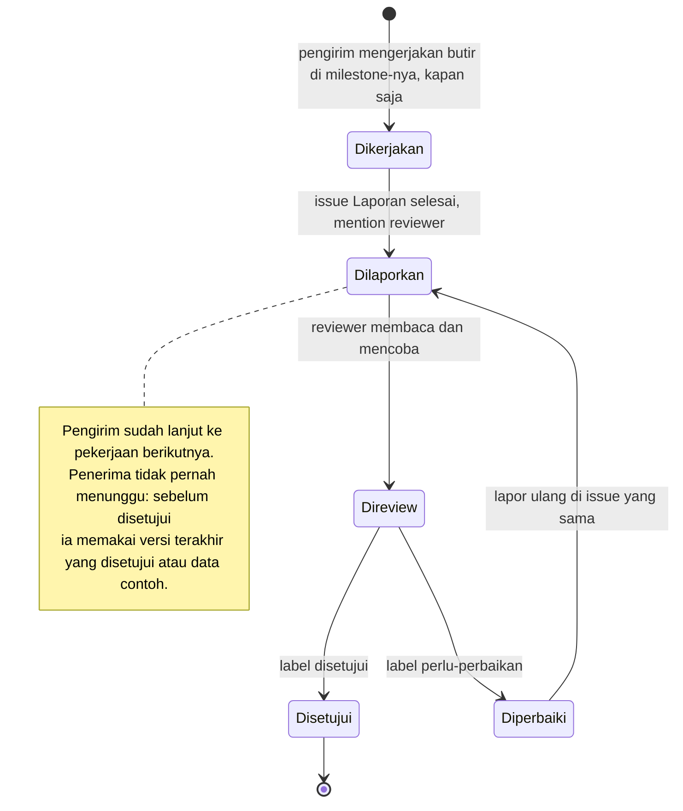

[Profil organisasi](https://github.com/DraftAja) · [Semua milestone](../milestone/README.md)

# Serah terima

Serah terima adalah titik ketika hasil kerja satu anggota menjadi bahan kerja anggota lain. Di diagram profil, setiap serah terima digambar sebagai panah mendatar dengan label `H<nomor> · <milestone pengirim> → <milestone penerima> · <isi>`. Setiap label punya halaman sendiri di folder ini, berisi isi paket, syarat sebelum dikirim, cara mengirim dan melapor, cara penerima mereview, dan apa yang dikerjakan penerima selama serah terima belum dilaporkan.

Serah terima **bukan gerbang**. Tidak ada anggota yang menunggu serah terima untuk mulai atau melanjutkan milestone-nya. Serah terima adalah laporan: pengirim memberi tahu bahwa hasilnya siap, dan penerima mereviewnya.

## Aturan umum

1. **Kerja paralel, kapan saja.** Setiap anggota mengerjakan milestone di lajurnya sendiri tanpa menunggu milestone atau serah terima anggota lain. Bila hasil orang lain belum ada, pakai data contoh, tipe sementara, atau provider palsu seperti yang ditulis di bagian "Selama belum dilaporkan" di setiap halaman serah terima.
2. **Selesai berarti dilaporkan di issue GitHub.** Pengirim membuka issue dengan template **Laporan selesai**: apa yang selesai, tautan PR dan bukti, label `H<n>` yang terkait, cara mereview, lalu mention reviewer. Pesan di grup hanya pemberitahuan, bukan bukti.
3. **Pengirim tidak menunggu tanggapan.** Setelah melapor, pengirim langsung lanjut ke butir atau milestone berikutnya.
4. **Reviewer menanggapi di issue yang sama**, sasaran 1×24 jam hari kerja sejak di-mention. Setuju: label `disetujui`. Tidak setuju: label `perlu-perbaikan` beserta daftar yang kurang.
5. **Rahasia tidak pernah lewat repo, issue, atau chat grup terbuka.** Kunci provider AI dan kredensial basis data diserahkan lewat kanal aman yang disepakati PM (H15, H16). Issue laporannya hanya mencatat "akses sudah diserahkan" beserta tanggalnya.

### Bila reviewer tidak setuju

Penolakan tidak menghentikan siapa pun.

1. Reviewer menulis alasan dan daftar perbaikan di issue laporan, lalu memasang label `perlu-perbaikan`.
2. Pengirim memperbaiki di branch baru, lalu melapor ulang **di issue yang sama** dengan komentar baru dan mention ulang reviewer. Ini kembali ke langkah serah terima sebelumnya (Dilaporkan), bukan membuat serah terima baru.
3. Selama perbaikan, penerima tetap bekerja memakai versi terakhir yang disetujui, atau data contoh bila belum pernah ada yang disetujui.
4. Bila tidak sepakat setelah dua putaran, PM memutuskan (kontrak tim bagian 14).

### Siapa yang di-mention

| Hasil dari | Mention |
|---|---|
| Octaf · `be-core` | `@abdhaamed` untuk kode API, `@alvirarisky` bila kontrak berubah, `@LuiLuiLui886` bila siap diuji, ditambah penerima di halaman H<n> |
| Hamid · `be-ai` | `@octafex` untuk kode API, `@alvirarisky` bila kontrak berubah, `@LuiLuiLui886` bila siap diuji, ditambah penerima di halaman H<n> |
| Alvira · `fe` | `@octafex` atau `@abdhaamed` sesuai endpoint yang dipakai, `@LuiLuiLui886` bila siap diuji |
| Louis · `qa` | Pemilik area temuan, `@rajafadhil` untuk tanda siap rilis |
| Raja · `pm` | Anggota yang terdampak keputusan |

Issue laporan dibuat di repo tempat pekerjaannya: Backend-Laravel untuk `be-core` dan `be-ai`, Frontend-Nextjs untuk `fe`. Laporan yang mencakup kedua repo, misalnya dari `pm` atau `qa`, dibuat di repo gabungan DraftAja.

## Siklus satu serah terima



## Kanal yang dipakai

| Kanal | Dipakai untuk | Bukti serah terima |
|---|---|---|
| Issue **Laporan selesai** dengan mention reviewer | Semua serah terima (H1 sampai H35) | Issue berlabel `laporan`; ditutup dengan label `disetujui` |
| PR API merge + label `butuh-fe` di issue web | Kontrak API baru yang dipakai FE (H6, H7, H12, H13, H17) | Issue web berlabel `butuh-fe` menautkan PR API yang sudah merge |
| Daftar periksa serah terima QA di deskripsi PR | Fitur siap diuji QA (H4, H5, H14) | Kotak centang di PR terisi, Louis disebut di PR |
| Komentar di issue `kontrak` + label `kontrak-disetujui` | Persetujuan kasus error (H2, H3) | Komentar persetujuan Louis, label dipasang Alvira |
| Issue keputusan yang ditutup | Keputusan produk (H9, H10, H11) | Issue tertutup dengan keputusan tertulis di komentar terakhir dan dokumen yang diperbarui |
| Kanal aman di luar repo | Rahasia dan akses infrastruktur (H15, H16) | Issue tanpa rahasia yang mencatat "akses sudah diserahkan" beserta tanggalnya |
| Dokumen di repo | Hasil uji (H19, H21) | Commit yang memperbarui doc 10 atau `docs-ai/07-testing.md` |
| CI hijau di `develop` | Bukti otomatis (H20) | Tautan run CI |
| Issue di repo gabungan DraftAja | Tanda rilis (H22) | Label `siap-rilis` pada issue pasangan commit |

## Daftar serah terima

| Fase | Label | Halaman |
|---|---|---|
| 0 | H1 · PM-1 → CORE-2 · kontrak tim v1.1, CODEOWNERS | [H1](H1.md) |
| 0 | H2 · QA-1 → CORE-2 · kasus error inti disetujui | [H2](H2.md) |
| 0 | H3 · QA-1 → AI-1 · kasus error AI disetujui | [H3](H3.md) |
| 0 | H4 · CORE-1 → QA-2 · fase 0 API siap uji | [H4](H4.md) |
| 0 | H5 · WEB-1 → QA-2 · fase 0 web siap uji | [H5](H5.md) |
| 0 | H6 · CORE-2 → WEB-2 · openapi.json inti baru | [H6](H6.md) |
| 0 | H7 · AI-1 → WEB-2 · tipe generate, tidy, chat | [H7](H7.md) |
| 0 | H8 · AI-2 → WEB-5 · stub provider untuk E2E | [H8](H8.md) |
| 1 | H9 · PM-2 → CORE-3 · kategori dan kolom identitas | [H9](H9.md) |
| 1 | H10 · PM-2 → AI-3 · persona asisten | [H10](H10.md) |
| 1 | H11 · PM-2 → WEB-3 · teks kebijakan privasi | [H11](H11.md) |
| 1 | H12 · CORE-3 → WEB-3 · final, revisi, konflik | [H12](H12.md) |
| 1 | H13 · AI-3 → WEB-3 · kuota dan proposal | [H13](H13.md) |
| 1 | H14 · WEB-3 → QA-3 · fase 1 siap uji | [H14](H14.md) |
| 2 | H15 · PM-3 → CORE-5 · PostgreSQL 16 sekali pakai | [H15](H15.md) |
| 2 | H16 · PM-3 → AI-4 · kunci Groq dan Gemini | [H16](H16.md) |
| 2 | H17 · CORE-4 → WEB-4 · kategori dan kolom isian | [H17](H17.md) |
| 2 | H18 · CORE-4 → QA-4 · 64 template di seeder | [H18](H18.md) |
| 2 | H19 · AI-5 → QA-4 · hasil regresi prompt | [H19](H19.md) |
| 2 | H20 · WEB-5 → QA-5 · E2E MVP hijau | [H20](H20.md) |
| 2 | H21 · CORE-5 → PM-4 · hasil tes PostgreSQL 16 | [H21](H21.md) |
| 2 | H22 · QA-5 → PM-4 · label siap-rilis | [H22](H22.md) |
| U | H23 · PM-6 → CORE-6 · ADR usaha dan batas add-on | [H23](H23.md) |
| U | H24 · PM-6 → AI-6 · ADR 0008 dan dependensi disetujui | [H24](H24.md) |
| U | H25 · QA-6 → CORE-6 · kasus uji rumus disetujui | [H25](H25.md) |
| U | H26 · QA-6 → AI-6 · kasus uji impor dan ekspor disetujui | [H26](H26.md) |
| U | H27 · CORE-6 → WEB-6 · openapi usaha, uang, stok | [H27](H27.md) |
| U | H28 · CORE-6 → AI-6 · service uang dan stok | [H28](H28.md) |
| U | H29 · CORE-7 → WEB-7 · openapi mitra dan invoice | [H29](H29.md) |
| U | H30 · CORE-7 → AI-7 · data invoice untuk rekap dan pengingat | [H30](H30.md) |
| U | H31 · AI-6 → WEB-7 · openapi lembar kerja, impor, ekspor | [H31](H31.md) |
| U | H32 · AI-7 → WEB-7 · openapi ringkasan, teks ke tabel, pengingat | [H32](H32.md) |
| U | H33 · AI-7 → QA-7 · hasil regresi prompt teks ke tabel | [H33](H33.md) |
| U | H34 · WEB-7 → QA-7 · Fase U siap uji | [H34](H34.md) |
| U | H35 · QA-7 → PM-4 · label siap-rilis Fase U | [H35](H35.md) |

## Daftar periksa serah terima QA

Dipakai H4, H5, dan H14. Salin ke deskripsi PR yang menyelesaikan fitur:

```markdown
## Serah terima ke QA
- [ ] Pasangan commit yang diuji: API `<sha>`, web `<sha>`
- [ ] Akun uji dan data yang dibutuhkan (seeder atau langkah manual)
- [ ] Keadaan yang ditangani, merujuk peta halaman web docs/03
- [ ] Tangkapan layar 360 px dan desktop (untuk perubahan tampilan)
- [ ] Kode error yang bisa dipicu dan cara memicunya
- [ ] Louis (QA) diminta sebagai reviewer di PR ini
```

---

🔒 = berkas di repo privat, hanya bisa dibuka anggota organisasi yang sudah masuk ke GitHub.
